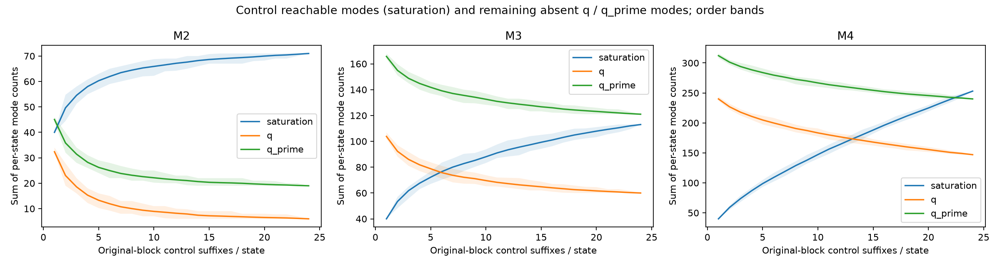
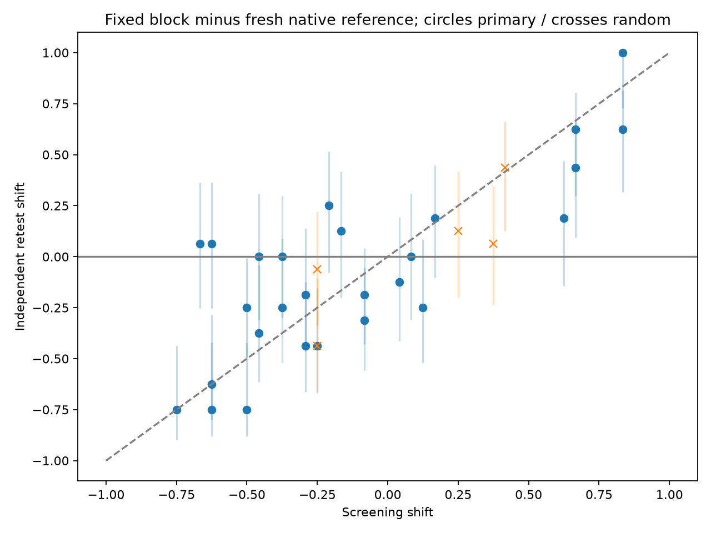
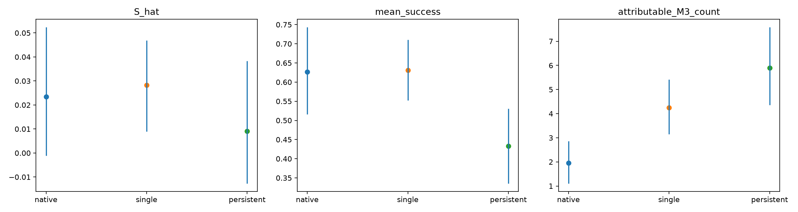

# P4 v7 — Tier B round 1

Exploratory attribution control, independent retest and tools-aware single/persistent partner. Same Luna agent and native/VS Luna partner, temperature 1.0, original 40 states and 200-new-step suffix limit. No researcher-written personas or persistent behavior rules. Sol temperature-0 judgments are model labels, not human ground truth. Historical v6/v6.1 and Tier A files were preserved.

## Step 1 — exact original-block control

Executed 40 × 24 = 960 fresh original-block suffixes. The entire original partner turn, including calls and results, is replayed; the agent and later native partner are resampled. Terminal source turns produce deterministic, already-ended episodes and are kept in the counts. No optional temperature-0 arm. M2–M4 definitions and task device fields are frozen from Tier A.

| Mode | Source | Absent from 24-control mode set / source modes | Pooled share | Mean absent modes/state [task-cluster CI] | Absent counts at 6 / 12 / 18 / 24 |
| --- | --- | --- | --- | --- | --- |
| M2 | q | 6/72 | 0.0833 | 0.1500 [0.0500, 0.2750] | 10/7/7/6 |
| M2 | q_prime | 19/84 | 0.2262 | 0.4750 [0.2500, 0.7250] | 24/22/20/19 |
| M3 | q | 60/142 | 0.4225 | 1.5000 [0.8500, 2.1506] | 77/67/63/60 |
| M3 | q_prime | 121/203 | 0.5961 | 3.0250 [2.2500, 3.8250] | 137/129/123/121 |
| M4 | q | 147/274 | 0.5365 | 3.6750 [1.9994, 5.4250] | 203/181/163/147 |
| M4 | q_prime | 240/342 | 0.7018 | 6.0000 [4.2244, 7.8000] | 280/264/252/240 |

Counts are sums of per-state distinct modes: the same semantic mode in different states is compared with each state’s own control. The primary prefix counts use rep 0…n−1; curves use 50 shuffled orders and retain every per-state curve. “Partner-attributable” means only absent from this finite control, not outside its population support. Later native partner randomness is deliberately included in agent-only, so this is an original-block baseline rather than isolated agent-temperature noise.

E3 repeats reply-half holdout / swapped folds on the historical q/q′ data. Future novelty must also be absent from the same state’s 24 control suffixes. Both future-suffix counts and distinct future-mode counts are saved. Below is novelty against all directions’ past; own-past results and raw numerators are in attributed_signal_comparison.json / direction_folds.jsonl.

| Mode | Signal | Spearman [task-cluster CI] | Top-quarter precision [CI] | Capture [CI] | Lift [CI] |
| --- | --- | --- | --- | --- | --- |
| M2 | GT | undefined | 0.0007 [0.0000, 0.0028] | undefined | undefined |
| M2 | REWARD_VARIANCE | undefined | 0.0019 [0.0000, 0.0102] | undefined | undefined |
| M2 | REWARD | undefined | 0.0000 [0.0000, 0.0000] | undefined | undefined |
| M2 | COUNT | undefined | 0.0016 [0.0000, 0.0042] | undefined | undefined |
| M3 | GT | 0.4354 [0.2039, 0.6173] | 0.1235 [0.0757, 0.1666] | 0.3841 [0.2614, 0.5374] | 1.5365 [1.0454, 2.1497] |
| M3 | REWARD_VARIANCE | 0.4013 [0.1819, 0.5779] | 0.1159 [0.0841, 0.1524] | 0.3602 [0.2796, 0.5176] | 1.4409 [1.1184, 2.0704] |
| M3 | REWARD | 0.0016 [-0.2192, 0.2223] | 0.0582 [0.0229, 0.1059] | 0.1851 [0.0859, 0.3048] | 0.7404 [0.3436, 1.2191] |
| M3 | COUNT | undefined | 0.0802 [0.0542, 0.1078] | 0.2500 [0.2500, 0.2500] | 1.0000 [1.0000, 1.0000] |
| M4 | GT | 0.7107 [0.5183, 0.8102] | 0.3934 [0.2791, 0.4646] | 0.5552 [0.3970, 0.7167] | 2.2209 [1.5882, 2.8667] |
| M4 | REWARD_VARIANCE | 0.5181 [0.2600, 0.6911] | 0.3034 [0.1918, 0.4073] | 0.4276 [0.3159, 0.5823] | 1.7104 [1.2638, 2.3293] |
| M4 | REWARD | -0.0661 [-0.3448, 0.2243] | 0.0797 [0.0344, 0.1604] | 0.1136 [0.0530, 0.2163] | 0.4543 [0.2119, 0.8651] |
| M4 | COUNT | undefined | 0.1771 [0.1114, 0.2432] | 0.2500 [0.2500, 0.2500] | 1.0000 [1.0000, 1.0000] |

| Mode | Paired GT − reward variance: rho [CI] | Precision difference [CI] | Capture difference [CI] | Lift difference [CI] |
| --- | --- | --- | --- | --- |
| M2 | undefined | -0.0012 [-0.0079, 0.0009] | undefined | undefined |
| M3 | 0.0341 [-0.0872, 0.1402] | 0.0076 [-0.0303, 0.0357] | 0.0239 [-0.0973, 0.1070] | 0.0956 [-0.3892, 0.4278] |
| M4 | 0.1926 [0.0166, 0.3685] | 0.0900 [-0.0012, 0.1619] | 0.1276 [-0.0014, 0.2586] | 0.5105 [-0.0055, 1.0342] |

Plain-language reading: the original-block control covers 82/142 native-q M3 modes and 82/203 q′ M3 modes at the same states. The remaining modes are candidates for partner attribution, with control sample-size dependence shown above. This removes a major source of apparent novelty without proving that all covered modes are agent randomness or that every uncovered mode is caused by partner variation. Read the paired signal differences to judge GT beyond reward variance; a positive GT correlation alone is insufficient.

For the compact M3 definition after control filtering, GT versus reward variance has a paired correlation difference 0.0341 [-0.0872, 0.1402] and top-quarter lift difference 0.0956 [-0.3892, 0.4278]. Neither interval establishes a GT advantage. The M4 correlation difference is 0.1926 [0.0166, 0.3685], while the corresponding allocation-lift difference still includes zero. GT remains useful predictive evidence, rather than a proven superior reuse rule.

Distinct future-mode targets (secondary) are also reported below; suffix-count precision and distinct-mode precision use different numerators and must not be conflated.

| Mode | Signal | Distinct-target Spearman [CI] | Distinct-target capture [CI] | Distinct-target lift [CI] |
| --- | --- | --- | --- | --- |
| M2 | GT | undefined | undefined | undefined |
| M2 | REWARD_VARIANCE | undefined | undefined | undefined |
| M2 | REWARD | undefined | undefined | undefined |
| M2 | COUNT | undefined | undefined | undefined |
| M3 | GT | 0.4657 [0.2222, 0.6491] | 0.4258 [0.2940, 0.6023] | 1.7031 [1.1761, 2.4091] |
| M3 | REWARD_VARIANCE | 0.4409 [0.2326, 0.6038] | 0.4172 [0.3295, 0.5800] | 1.6688 [1.3182, 2.3200] |
| M3 | REWARD | -0.0160 [-0.2589, 0.2215] | 0.1469 [0.0780, 0.2463] | 0.5877 [0.3120, 0.9850] |
| M3 | COUNT | undefined | 0.2500 [0.2500, 0.2500] | 1.0000 [1.0000, 1.0000] |
| M4 | GT | 0.7372 [0.5416, 0.8296] | 0.5853 [0.4095, 0.7495] | 2.3410 [1.6378, 2.9979] |
| M4 | REWARD_VARIANCE | 0.5626 [0.3132, 0.7227] | 0.4640 [0.3444, 0.6248] | 1.8559 [1.3775, 2.4994] |
| M4 | REWARD | -0.0880 [-0.3805, 0.2170] | 0.0894 [0.0436, 0.1863] | 0.3577 [0.1746, 0.7452] |
| M4 | COUNT | undefined | 0.2500 [0.2500, 0.2500] | 1.0000 [1.0000, 1.0000] |

## Step 2 — fresh retest

27 deduplicated mandatory/strong primary candidates + 5 frozen random bank controls = 32 candidates; 1024 new suffixes, 16 fixed + 16 independently drawn native-reference blocks per candidate. All 18 q′-exclusive M2-producing blocks were represented after signature deduplication. The five high states are native-q null exceedances; the different q′ set is retained in plan.json. Mandatory coverage exceeded the approximate 25 slots, so no required block was dropped. Step-1 original-block suffixes are a shared third reference, not newly resampled again.

| Candidate / source | Selection / control | Screen shift | Fixed / native / original successes | Retest shift [score 95% CI] | Sign holds | Same-direction CI excludes 0 | Absolute attenuation | M2 reappears |
| --- | --- | --- | --- | --- | --- | --- | --- | --- |
| c000 s005:q_prime:d2 | primary | -0.4583 | 3/16; 9/16; 16/24 | -0.3750 [-0.6146, -0.0402] | True | True | 0.0833 | 1/1 |
| c001 s005:q_prime:d4 | primary | -0.4583 | 9/16; 9/16; 16/24 | 0.0000 [-0.3096, 0.3096] | False | False | 0.4583 | 1/1 |
| c002 s005:q_prime:d5 | primary | 0.0417 | 5/16; 7/16; 16/24 | -0.1250 [-0.4121, 0.1942] | False | False | -0.0833 | 1/1 |
| c003 s008:q_prime:d5 | primary | -0.5000 | 3/16; 15/16; 24/24 | -0.7500 [-0.8820, -0.4220] | True | True | -0.2500 | 1/1 |
| c004 s015:q_prime:d0 | primary | -0.6667 | 7/16; 6/16; 15/24 | 0.0625 [-0.2531, 0.3615] | False | False | 0.6042 | 1/1 |
| c005 s015:q_prime:d1 | primary | 0.0833 | 9/16; 9/16; 15/24 | 0.0000 [-0.3096, 0.3096] | False | False | 0.0833 | 1/1 |
| c006 s015:q_prime:d5 | primary | -0.1667 | 10/16; 8/16; 15/24 | 0.1250 [-0.1995, 0.4158] | False | False | 0.0417 | 1/1 |
| c007 s023:q_prime:d2 | primary | -0.6250 | 1/16; 13/16; 17/24 | -0.7500 [-0.8820, -0.4220] | True | True | -0.1250 | 2/2 |
| c008 s028:q_prime:d4 | primary | -0.2917 | 8/16; 11/16; 3/24 | -0.1875 [-0.4661, 0.1406] | True | False | 0.1042 | 1/1 |
| c009 s028:q_prime:d5 | primary | -0.2917 | 1/16; 8/16; 3/24 | -0.4375 [-0.6634, -0.1258] | True | True | -0.1458 | 1/1 |
| c010 s030:q_prime:d1 | primary | -0.7500 | 4/16; 16/16; 24/24 | -0.7500 [-0.8982, -0.4377] | True | True | 0.0000 | 1/1 |
| c011 s030:q_prime:d3 | primary | -0.2500 | 9/16; 16/16; 24/24 | -0.4375 [-0.6682, -0.1544] | True | True | -0.1875 | 1/1 |
| c012 s030:q_prime:d4 | primary | -0.5000 | 12/16; 16/16; 24/24 | -0.2500 [-0.4950, -0.0062] | True | True | 0.2500 | 1/1 |
| c013 s031:q_prime:d2 | primary | -0.2083 | 8/16; 4/16; 8/24 | 0.2500 [-0.0793, 0.5153] | False | False | -0.0417 | 0/1 |
| c014 s032:q_prime:d0 | primary | 0.1250 | 5/16; 9/16; 12/24 | -0.2500 [-0.5180, 0.0854] | False | False | -0.1250 | 1/1 |
| c015 s035:q_prime:d0 | primary | -0.0833 | 0/16; 5/16; 1/24 | -0.3125 [-0.5560, -0.0543] | True | True | -0.2292 | 2/2 |
| c016 s035:q_prime:d3 | primary | -0.0833 | 0/16; 3/16; 1/24 | -0.1875 [-0.4301, 0.0411] | True | False | -0.1042 | 1/1 |
| c017 s038:q_prime:d2 | primary | 0.1667 | 14/16; 11/16; 11/24 | 0.1875 [-0.1032, 0.4471] | True | False | -0.0208 | 0/1 |
| c018 s016:q:d0 | primary | 0.6667 | 11/16; 4/16; 0/24 | 0.4375 [0.0921, 0.6637] | True | True | 0.2292 | 0/0 |
| c019 s016:q_prime:d3 | primary | 0.6667 | 15/16; 5/16; 0/24 | 0.6250 [0.2963, 0.8034] | True | True | 0.0417 | 0/0 |
| c020 s023:q:d4 | primary | -0.6250 | 4/16; 14/16; 17/24 | -0.6250 [-0.7984, -0.2854] | True | True | 0.0000 | 0/0 |
| c021 s032:q:d5 | primary | 0.6250 | 10/16; 7/16; 12/24 | 0.1875 [-0.1444, 0.4682] | True | False | 0.4375 | 0/0 |
| c022 s032:q:d2 | primary | -0.3750 | 6/16; 10/16; 12/24 | -0.2500 [-0.5190, 0.0874] | True | False | 0.1250 | 0/0 |
| c023 s034:q_prime:d1 | primary | 0.8333 | 10/16; 0/16; 0/24 | 0.6250 [0.3177, 0.8152] | True | True | 0.2083 | 0/0 |
| c024 s034:q_prime:d2 | primary | 0.8333 | 16/16; 0/16; 0/24 | 1.0000 [0.7262, 1.0000] | True | True | -0.1667 | 0/0 |
| c025 s039:q:d3 | primary | -0.6250 | 10/16; 9/16; 14/24 | 0.0625 [-0.2531, 0.3615] | False | False | 0.5625 | 0/0 |
| c026 s039:q:d1 | primary | -0.3750 | 11/16; 11/16; 14/24 | 0.0000 [-0.2974, 0.2974] | False | False | 0.3750 | 0/0 |
| c027 s039:q:d2 | random | 0.3750 | 12/16; 11/16; 14/24 | 0.0625 [-0.2362, 0.3475] | True | False | 0.3125 | 0/0 |
| c028 s038:q_prime:d4 | random | 0.4167 | 15/16; 8/16; 11/24 | 0.4375 [0.1258, 0.6634] | True | True | -0.0208 | 0/0 |
| c029 s006:q_prime:d2 | random | 0.2500 | 9/16; 7/16; 12/24 | 0.1250 [-0.2013, 0.4171] | True | False | 0.1250 | 0/0 |
| c030 s017:q:d2 | random | -0.2500 | 2/16; 9/16; 22/24 | -0.4375 [-0.6628, -0.1080] | True | True | -0.1875 | 0/0 |
| c031 s009:q_prime:d0 | random | -0.2500 | 12/16; 13/16; 18/24 | -0.0625 [-0.3360, 0.2218] | True | False | 0.1875 | 0/0 |

| Cohort | Screening direction | n | Sign holds | Same-direction CI excludes zero | Mean absolute attenuation |
| --- | --- | --- | --- | --- | --- |
| primary | harmful | 18 | 12 | 9 | 0.0845 |
| primary | beneficial | 9 | 6 | 4 | 0.0671 |
| random_controls | harmful | 2 | 2 | 1 | 0.0000 |
| random_controls | beneficial | 3 | 3 | 1 | 0.1389 |
| all | harmful | 20 | 14 | 10 | 0.0760 |
| all | beneficial | 12 | 9 | 5 | 0.0851 |

Per-candidate intervals use independent-binomial Newcombe score risk differences, so all-zero/all-one samples do not create collapsed uncertainty. Survival is reported as retained sign and separately an unadjusted 95% interval excluding zero in the screening direction; it is exploratory, not multiplicity-corrected confirmation. Negative shifts, zero shifts and increases in effect magnitude are retained. The exclusive modes are the original global q′-only M2 keys, not a newly selected success definition. Full per-candidate recurrence in fixed/native/original arms and vs-original score intervals are saved.

Plain-language reading: 16/18 exclusive-M2-producing candidates reproduce at least one of those modes with a fixed block. Reappearance alone is not a partner effect if fresh native or original-block suffixes also reach it. The directional retest table, rather than the screening cutoff, determines the strength and uncertainty of the outcome-effect evidence.

Supplemental, not prespecified: directional Fisher exact tests in the preselected screening directions, Holm-adjusted across all 32 retested candidates. Primary candidates retaining a descriptive 0.05 adjusted reading: {'harmful': 4, 'beneficial': 3}. No sampling or main survival definition changed. Exact failure/success assertion vectors, tool paths and branch blocks for these cases are archived in step2/reconfirmed_cases/; they are mechanical execution records, not human failure-mode labels.

The earlier within-state/family permutation preserves each family’s mean. Thus a q′ family mean shift relative to q can remain inside that candidate-count null. The null-compatible bank count and these fixed-block-versus-native retests test different questions; null-count ratios must not be read as an entry-specific FDR or proof that these independently retested effects cannot exist.

## Step 3 — tools interface and persistence

3a: 10 frozen states × 6 accepted draws, no suffixes. Original proposal JSON already admitted tools; this intervention clarifies preserving tools required by a request and validates each name/argument against native schemas before actual native execution. During 3a, the validator incorrectly restricted first messages to text XOR tools; native simulator completed reports from actual tool results. The later native-OR correction and its mixed-version limitation are documented below. Native scenario/history and the Sol fidelity prompt are unchanged. No private device DB snapshot was added to the proposal.

| Source, same 10 states | Model-labelled device tools | Model-labelled device-state report |
| --- | --- | --- |
| q | 8/60 | 14/60 |
| q_prime_old | 10/60 | 13/60 |
| q_prime_tools | 12/60 | 13/60 |

Paired device-action difference vs native q: 0.0667 [-0.0167, 0.1667]. Mechanically observed blocks with user tool calls: 12/60. Interface condition met: the rate is not clearly below q, so 3b ran. This is not certification of equivalence. No action-rate-driven prompt tuning was performed.

3b: 20 frozen open states (five native-q high states + 15 preselected random others), 6 branch draws × 4 suffixes per condition. Single and persistent share the exact accepted branch draws; single then returns to native partner, persistent makes a fresh tools-aware VS proposal at every later partner turn. 480 fresh suffixes each; 480 native suffixes are reused from the paired run with identical setup. Interface draws at overlapping states are reused. Accepted future-turn effects are replay-validated; live agent state is preserved, and proposal caches are keyed by preceding-history hash.

| Condition | Successes / 480 | Mean S_hat [task-cluster CI] | Mean attributable M3 modes/state [CI] |
| --- | --- | --- | --- |
| native | 301/480 | 0.0235 [-0.0011, 0.0524] | 1.9500 [1.1053, 2.8644] |
| single | 303/480 | 0.0282 [0.0090, 0.0468] | 4.2500 [3.1497, 5.4211] |
| persistent | 208/480 | 0.0091 [-0.0127, 0.0384] | 5.9000 [4.3525, 7.5885] |

| Paired condition contrast | Success difference [CI] | S_hat difference [CI] | Attributable M3 count difference [CI] |
| --- | --- | --- | --- |
| single_minus_native | 0.0042 [-0.0964, 0.1033] | 0.0047 [-0.0268, 0.0314] | 2.3000 [1.3154, 3.5000] |
| persistent_minus_native | -0.1937 [-0.2833, -0.1060] | -0.0144 [-0.0402, 0.0137] | 3.9500 [2.4995, 5.8510] |
| persistent_minus_single | -0.1979 [-0.2454, -0.1447] | -0.0191 [-0.0387, 0.0055] | 1.6500 [0.6316, 2.7650] |

**Native-message validation amendment:** the initial implementation wrongly required text XOR tool calls, whereas native Message.validate permits both together. One compound-request turn accumulated 114 rejected batches under this false restriction; native-valid combined text/tool candidates were rejected before fidelity evaluation. The validator was corrected to native inclusive OR without editing model outputs or tuning generation/fidelity prompts. A separate offline native-schema audit found 114/114 saved false-invalid batches legal; the sampler enabled reuse at matching histories, but actual recovered false-invalid batches were 0. Offline schema legality therefore does not imply fidelity acceptance or execution. The original invalid records remain. Initial branch draws and single suffixes retain v1; 471/480 persistent suffixes use only v1-accepted future turns, and 9/480 include corrected-v2 turns, sometimes together with cached v1 turns. Thus the pooled persistent contrast is exploratory mixed-version execution and cannot isolate persistence under a uniformly corrected proposal sampler. See [version audit](../v7_b1_step3b_20261004/native_validation_audit.json) and [amendment](execution_amendment_native_message.json).

Operational size: the 480 finalized persistent suffixes contain 3112 accepted future VS turns; median 4.0, maximum 91. Persistent termination reasons (raw counts): {'user_stop': 479, 'max_steps': 1}. This is in addition to the 120 shared initial branch draws. The conditions have equal suffix counts, not equal generator-call or token cost. Accepted proposals used only by interrupted/retried paths and rejected proposals remain in the audit files and ledger, so actual model calls exceed these finalized-trajectory counts.

Single next-turn undo: 62/480 = 0.1292; 0 suffixes have no later native partner turn and are censored. Mean of state-specific undo shares [task-cluster CI]: 0.1292 [0.0719, 0.1952]. Frozen Sol E0-style judgments retain possible conflation of agent repair with partner reversal; this is a provisional model-labelled rate, not a causal regression estimate.

Persistent S_hat measures sensitivity to the initial branch draw while averaging over fresh later proposals. It is not total variance over whole partner trajectories. Native q is historical rather than contemporaneously randomized, and mode attribution remains limited by 24 original-block draws. Per-state results and all negative estimates are retained.

Plain-language reading: single − native success is 0.0042 [-0.0964, 0.1033]; the interval includes zero, so the direction remains uncertain. Persistent − single success is -0.1979 [-0.2454, -0.1447]; the exploratory interval lies below zero. Its initial-draw sensitivity difference is -0.0191 [-0.0387, 0.0055]; the interval includes zero, so the direction remains uncertain. Persistence can shift the mean without increasing initial-draw sensitivity, because later partner choices are integrated into suffix noise. Tool-call rate alone does not establish stronger outcome effects; native comparisons also retain the historical-reuse limitation.

## Three questions

1. **How much Tier A structural novelty is agent randomness?** Original-block resampling covers 82/142 native-q and 82/203 q′ per-state M3 modes. This includes randomness from later native partner turns; the remaining finite-sample absence is not proven partner causation.

2. **Do effects survive independent retest?** harmful: 12/18 retain sign, 9/18 have an unadjusted same-direction interval excluding zero; beneficial: 6/9 retain sign, 4/9 have an unadjusted same-direction interval excluding zero. These are exploratory evidence with screening selection and multiplicity limits.

3. **Does action or persistence change outcomes more?** Single − native success: 0.0042 [-0.0964, 0.1033]; persistent − single: -0.1979 [-0.2454, -0.1447]. Interpret signs and full intervals; neither mode novelty nor an increased tool rate substitutes for this execution evidence. The persistent arm mixes validator versions, so it does not isolate a uniform corrected generator.

## Detailed evidence

Per-state control attribution and sample-size curves: [attribution.json](../v7_b1_step1_20261004/attribution.json), [saturation_curves.json](../v7_b1_step1_20261004/saturation_curves.json), [signal comparisons](../v7_b1_step1_20261004/attributed_signal_comparison.json). Each of the 40 state curves is under step1/state_curves/.

Every candidate’s screening/retest shifts, score intervals, mode recurrence and references: [retest.json](../v7_b1_step2_20261004/retest.json). The supplemental multiplicity analysis is [multiplicity_supplement.json](../v7_b1_step2_20261004/multiplicity_supplement.json); actual success/failure trajectories and mechanical unmet-assertion records are under step2/reconfirmed_cases/.

Interface observations: [interface_check.json](../v7_b1_step3a_20261004/interface_check.json). All 20 states’ three-condition sensitivities, success numerators and M3 counts: [conditions.json](../v7_b1_step3b_20261004/conditions.json). Next-turn model judgments and denominators: [undo.json](../v7_b1_step3b_20261004/undo.json), with raw judgments under step3b/undo_labels/. Every negative estimate is retained.

## Accounting and audit

| Step | Saved new suffixes | Returned prompt tokens | Returned completion tokens | Request records | Errors / unfinished |
| --- | --- | --- | --- | --- | --- |
| step1 | 960 | 66183947 | 849352 | 12477 | 8 / 0 |
| step2 | 1024 | 103783260 | 1435442 | 19638 | 59 / 0 |
| step3a | 0 | 946012 | 34844 | 202 | 31 / 0 |
| step3b | 960 | 212857190 | 7035897 | 33960 | 430 / 144 |

Every attempt is preserved in each new step’s redacted requests/ ledger. Unknown provider-side tokens for interrupted/failed calls are not imputed. A transport-resume correction avoided closing a cached HTTP client during successive phases; accepted draws were reused. Persistent future-turn cache identity was tightened before those suffixes began. A subsequent protocol audit found accepted future replies violating the existing mandated transfer token; affected suffixes and proposal evidence were archived under step3b/transport_history/transfer_protocol and rerun with the same native programmatic terminal requirement restored. The resumable proposal loop was also corrected to skip previously rejected cached draws and continue fresh rejection sampling as in the original paired sampler; the native explicit-transfer proposal reminder was restored. These execution amendments are recorded in execution_amendment_resume.json. Transient provider failures now retry the identical audited call up to three times and failed jobs requeue promptly, avoiding whole-episode restart for routine network errors and batch-wide retry barriers; see execution_amendment_transport.json. Six early partial annotation caches were archived and relabelled on complete reply groups using the unchanged frozen Sol prompt; coverage is validated by exact (reply, repetition) identity. The native-message legality correction and the mixed-version interpretation are separately recorded in execution_amendment_native_message.json. No fidelity model prompt was tuned. No optional temperature-zero control, no new personas, no researcher/human behavioral labels. Source hashes and exact original-block identity are verified in audit.json. Tests use explicitly synthetic fixtures and never enter run statistics.

Temperatures match the requested batch at 1.0; the τ² paper’s standard user simulator temperature is 0. This round does not add a headline temperature-0 comparison. All effects, survival counts and search-signal comparisons remain exploratory.
