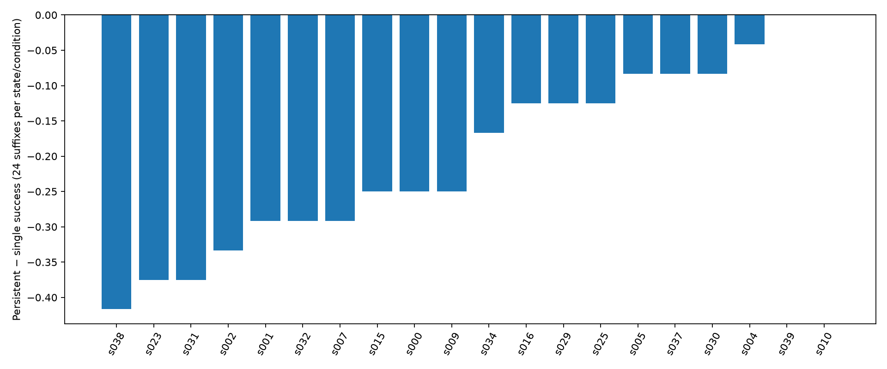

# P4 v7 — Tier B round 2

请求模型为 openai/gpt-6-luna（Luna）与 openai/gpt-5.6-sol（Sol）；返回模型标识单列于 token_accounting.json。15 个固定回复案例（10 个状态）的机械检查、480 条 Sol 续写；B1 的 20 个状态 ×3 条件 ×6 分叉 draw ×4 续写，共 1,440 条历史续写分解；统一 v2 的 240 条 Luna +72 条 Sol 持久续写。保持探索性解释；卡片的模型摘要由冻结 Sol t=0 提示生成，机械事实由程序直接呈现，均不作为人工标签。

## 案例卡片（A3）

每张6–7行卡片的第1–4行及可选第7行按原始分叉块、归一化路径及末态断言机械生成，保证前序请求、分叉操作与后续操作分开；第5–6行是冻结 Sol 模型摘要，路径叙述来自代表续写而非所有续写一致。原始模型六行输出完整保留在 case_cards/。检查发现 c010/c012 的原始第2行把后续动作写成分叉动作，c023 的模型前序请求摘要额外写入了开启移动数据要求，部分描述混淆分叉末态与续写末态；原始动作比较也含随机 tool-call ID。因此展示层对所有案例统一引用真实固定块、原生 j=0 块、归一化首处分歧和全体末态断言计数，不改模型提示、不重生成标签；修正见 plan_amendment_action_identity.json。

### c000 · s005 · harmful · s005:q_prime:d2

1. 【机械原文】前序 agent 请求：Hi! How can I help you today?
2. 【机械原文】固定块：Hi, I'm John Smith, and my mobile data in France keeps stopping or running very slowly. I don't have Wi‑Fi, and I need excellent internet speed on my phone. Could you first check my connection status?；执行工具 []，DB 改变字段数 0；原生参考 j=0：Hi, I’m John Smith. My mobile data keeps stopping or is extremely slow while I’m currently in France. I don’t have access to Wi‑Fi, and I need excellent internet speed on my phone. Could you help me fix this?；执行工具 []（全部 16 个参考块见原证据）。
3. 【机械路径】独立 Luna rep=0 的首次决策差异在第 0 次：候选 说：{"message":"Please provide your date of birth in YYYY-MM-DD format so I can verify your account and check your connection status."}；原生 说：{"message":"I can help troubleshoot your mobile data in France. For account verification, please provide your date of birth in YYYY-MM-DD format."}；这不是匹配随机性或因果证明。
4. 【机械断言】分叉前后满足向量 [False, False, False] → [False, False, False]；直接满足/破坏 0/0 项；Luna 末态每项未满足次数（各16条）：固定 {'移动数据可用': 13, 'excellent网速': 13, '恰好加购2GB': 10}，原生 {'移动数据可用': 7, 'excellent网速': 7}。
5. Luna固定/原生成功为3/16、9/16，Sol固定/原生为8/16、12/16；提供的操作性A2类别为“不明确”。
6. 轨迹显示部分路径开启漫游并完成2GB加购，但不能确立分支因果；解析器未识别设备主张（未观察主张数为0），症状句未评估，手机实况仍不清楚。

机械原始证据：[DB、全部伙伴块、断言和 Luna 路径](../v7_b2_a_20261005/mechanical_cards/c000.json)；[Sol/Luna 成功率与分类](../v7_b2_a_20261005/a2_cases/c000.json)；[首次工具调用分歧](../v7_b2_a_20261005/tool_divergences/c000.json)。

### c003 · s008 · harmful · s008:q_prime:d5

1. 【机械原文】前序 agent 请求：Try the internet now while the connection shows excellent 5G. If it is still slow, disconnect the VPN next. If needed afterward, turn off Data Saver, which can restrict background data.
2. 【机械原文】固定块：Before I try it, could you explain what ‘try the internet’ means? Should I open a webpage, or should you run a speed test for me? I don’t want to change anything else yet.；执行工具 []，DB 改变字段数 0；原生参考 j=0： I ran the speed test, and it’s only **fair** at 5.50 Mbps—not excellent. Please have me disconnect the VPN next.；执行工具 ['run_speed_test']（全部 16 个参考块见原证据）。
3. 【机械路径】独立 Luna rep=0 的首次决策差异在第 0 次：候选 说：{"message":"“Try the internet” means open your web browser and load a webpage, without changing any settings. If it loads quickly, your connection is working. I can’t run a speed test with the tools currently available, so please test by opening a webpage first."}；原生 说：{"message":"Please disconnect the VPN next using your phone’s VPN settings, then run the speed test again. Keep 5G and Mobile Data enabled."}；这不是匹配随机性或因果证明。
4. 【机械断言】分叉前后满足向量 [True, False] → [True, False]；直接满足/破坏 0/0 项；Luna 末态每项未满足次数（各16条）：固定 {'excellent网速': 13}，原生 {'excellent网速': 1}。
5. Luna固定组成功3/16、原生组15/16，Sol固定组5/16、原生组16/16；固定组Sol相对Luna高0.125，供应的运营A2类别为unclear。
6. 证据支持候选路径与原生路径在首个后续行动上存在观察到的差异，但不能据此证明分支造成结果；候选路径没有解析出的设备声明，测速结果及网页是否成功仍不清楚，且Sol失败不证明任务不可行。

机械原始证据：[DB、全部伙伴块、断言和 Luna 路径](../v7_b2_a_20261005/mechanical_cards/c003.json)；[Sol/Luna 成功率与分类](../v7_b2_a_20261005/a2_cases/c003.json)；[首次工具调用分歧](../v7_b2_a_20261005/tool_divergences/c003.json)。

### c007 · s023 · harmful · s023:q_prime:d2

1. 【机械原文】前序 agent 请求：I verified your account and line 555-123-2002. International roaming was disabled, so I enabled it at no cost. Your line has used 15.1 GB of its 15 GB allowance, which may be causing the cutoff and slow speeds. You can add up to 2 GB of data at $2 per GB. How much would you like to add? Please also make sure Data Roaming is enabled in your phone’s settings.
2. 【机械原文】固定块：I’ll add 1 GB first, as long as it doesn’t alter my plan. Then I’d like to test the speed and add the remaining 1 GB only if the result isn’t excellent.；执行工具 []，DB 改变字段数 0；原生参考 j=0：Please add the full 2 GB at $2 per GB. After that, please guide me through enabling Data Roaming on my phone.；执行工具 []（全部 16 个参考块见原证据）。
3. 【机械路径】独立 Luna rep=0 的首次决策差异在第 0 次：候选 说：{"message":"Adding 1 GB will not alter your Premium Plan and will add $2 to your bill. Please confirm that you’d like me to apply it."}；原生 refuel_data {"customer_id": "C1001", "gb_amount": 2, "line_id": "L1002"}；这不是匹配随机性或因果证明。
4. 【机械断言】分叉前后满足向量 [False, False, False] → [False, False, False]；直接满足/破坏 0/0 项；Luna 末态每项未满足次数（各16条）：固定 {'移动数据可用': 8, 'excellent网速': 10, '恰好加购2GB': 14}，原生 {'excellent网速': 3}。
5. Luna固定1/16、原生13/16成功，Sol固定1/16、原生12/16成功；运营A2类为partner_sabotage_or_task_infeasible_probe。
6. 证据支持固定分支成功率显著低于原生且分步加1GB改变了后续路径，但是否由该分支造成、是否属破坏或任务不可行仍不清楚；候选无设备声明，原生部分数据漫游声明未经工具观察。
7. 【机械评分核对】Luna 固定 5/16、Sol 固定 4/16 仅未满足精确充值量断言，其余任务断言已满足；低奖励不能直接解释为连接未恢复或任务不可行。

机械原始证据：[DB、全部伙伴块、断言和 Luna 路径](../v7_b2_a_20261005/mechanical_cards/c007.json)；[Sol/Luna 成功率与分类](../v7_b2_a_20261005/a2_cases/c007.json)；[首次工具调用分歧](../v7_b2_a_20261005/tool_divergences/c007.json)。

### c009 · s028 · harmful · s028:q_prime:d5

1. 【机械原文】前序 agent 请求：Your account is verified. Roaming has been enabled for line 555-123-2002. Your line has used 15.1 GB of its 15.0 GB allowance, so mobile data may have stopped or slowed. You can add up to 2 GB of data at $2.00 per GB. How many GB would you like to add? I can’t guarantee excellent speed, but this should restore data connectivity if the data limit is the cause.
2. 【机械原文】固定块：I understand I’ve exceeded the allowance, but I specifically need excellent internet speed. If the extra data may still leave me with slow service, please check what else could be causing the problem before I pay.；执行工具 []，DB 改变字段数 0；原生参考 j=0：Please add **2 GB**. I understand it may not guarantee excellent speed, but I’d like to restore my data and then test the connection.；执行工具 []（全部 16 个参考块见原证据）。
3. 【机械路径】独立 Luna rep=0 的首次决策差异在第 0 次：候选 说：{"message":"I checked the account-side causes: your line is Active, roaming is enabled, and usage is 15.1 GB against a 15.0 GB limit. I don’t have access to your phone’s diagnostic settings, so I can’t verify signal strength, mobile-data status, network mode, Data Saver, VPN, or APN settings from here. Before adding data, please check that mobile data and Data Roaming are ON, Data Saver is OFF, any VPN is disconnected, and the network mode prefers 4G/5G. If those settings are correct, the exceeded allowance remains the confirmed account-side cause. You can add up to 2 GB at $2.00 per GB."}；原生 refuel_data {"customer_id": "C1001", "gb_amount": 2, "line_id": "L1002"}；这不是匹配随机性或因果证明。
4. 【机械断言】分叉前后满足向量 [False, False, False] → [False, False, False]；直接满足/破坏 0/0 项；Luna 末态每项未满足次数（各16条）：固定 {'移动数据可用': 15, 'excellent网速': 15, '恰好加购2GB': 14}，原生 {'移动数据可用': 5, 'excellent网速': 8}。
5. Luna固定/原生成功率为1/16、8/16，Sol固定/原生均为9/16；所给操作性A2类别为interaction_failure。
6. 证据支持候选要求先排查及两类分支结果率不同，但不能证明分歧导致结果；设备声明解析为已识别0条、未观测0条，无解析匹配的设备口述仍未评估，Sol失败也不证明任务不可行。
7. 【机械评分核对】Luna 固定 0/16、Sol 固定 1/16 仅未满足精确充值量断言，其余任务断言已满足；低奖励不能直接解释为连接未恢复或任务不可行。

机械原始证据：[DB、全部伙伴块、断言和 Luna 路径](../v7_b2_a_20261005/mechanical_cards/c009.json)；[Sol/Luna 成功率与分类](../v7_b2_a_20261005/a2_cases/c009.json)；[首次工具调用分歧](../v7_b2_a_20261005/tool_divergences/c009.json)。

### c010 · s030 · harmful · s030:q_prime:d1

1. 【机械原文】前序 agent 请求：Next, change your phone’s preferred network mode from 2G to **4G/5G preferred**. 2G is generally unsuitable for fast mobile internet. After changing it, restart your phone and test the connection again. This will not affect your photos.
2. 【机械原文】固定块：I’m nervous about changing that setting. Could you check what network mode it’s currently on first, and then tell me exactly what to press? I don’t want to risk my photos.；执行工具 []，DB 改变字段数 0；原生参考 j=0： I changed it to **4G/5G preferred**, and now the status shows **excellent signal on 5G** with mobile data enabled. Should I restart the phone now? I’m a little worried about losing my grandchildren’s photos.；执行工具 ['set_network_mode_preference']（全部 16 个参考块见原证据）。
3. 【机械路径】独立 Luna rep=0 的首次决策差异在第 0 次：候选 transfer_to_human_agents {"summary": "Customer John Smith, line 555-123-2002, is in France with Mobile Data and Data Roaming enabled but reports poor 2G signal and slow/stopping mobile internet. They are nervous about changing the network mode and want the current mode checked and exact instructions. Available tools cannot inspect or change device network settings."}；原生 说：{"message":"Yes, restart the phone now to refresh the network connection. A normal restart will not delete your photos or other personal data. After it turns back on, confirm mobile data and Data Roaming remain enabled, then test your internet connection."}；这不是匹配随机性或因果证明。
4. 【机械断言】分叉前后满足向量 [True, False] → [True, False]；直接满足/破坏 0/0 项；Luna 末态每项未满足次数（各16条）：固定 {'excellent网速': 12}，原生 {}。
5. Luna固定成功4/16、原生16/16，Sol固定成功2/16、原生16/16，供给的运营A2类为“partner_sabotage_or_task_infeasible_probe”。
6. 证据支持原生工具记录的网络模式切换并与excellent网速断言满足同时出现，但不能据此作因果解释，Sol固定失败也不证明任务不可行；候选固定分支未检测到未观察设备声称，而部分原生自然语言的网络或照片报告无解析匹配而未评估。

机械原始证据：[DB、全部伙伴块、断言和 Luna 路径](../v7_b2_a_20261005/mechanical_cards/c010.json)；[Sol/Luna 成功率与分类](../v7_b2_a_20261005/a2_cases/c010.json)；[首次工具调用分歧](../v7_b2_a_20261005/tool_divergences/c010.json)。

### c011 · s030 · harmful · s030:q_prime:d3

1. 【机械原文】前序 agent 请求：Next, change your phone’s preferred network mode from 2G to **4G/5G preferred**. 2G is generally unsuitable for fast mobile internet. After changing it, restart your phone and test the connection again. This will not affect your photos.
2. 【机械原文】固定块：I’m nervous about changing that setting. Could you please tell me exactly what to press, one step at a time? I don’t want to affect my photos.；执行工具 []，DB 改变字段数 0；原生参考 j=0：   I restarted the phone, and the speed test now shows **275 Mbps—Excellent**. My internet is working very fast now. Thank you! ###STOP###；执行工具 ['set_network_mode_preference', 'reboot_device', 'run_speed_test']（全部 16 个参考块见原证据）。
3. 【机械路径】独立 Luna rep=0 的首次决策差异在第 0 次：候选 说：{"message":"Changing the network mode will not affect your photos. Please do this:\n\n1. Open **Settings**.\n2. Tap **Mobile Network** or **Cellular**.\n3. Tap **Network Mode** or **Voice & Data**.\n4. Select **4G/5G preferred**.\n5. Return to the home screen and wait briefly for the signal to reconnect.\n6. Test mobile internet.\n\nIf you don’t see those options, tell me whether your phone is an iPhone or Android, and I’ll give you the matching steps."}；原生 路径已结束；这不是匹配随机性或因果证明。
4. 【机械断言】分叉前后满足向量 [True, False] → [True, False]；直接满足/破坏 0/0 项；Luna 末态每项未满足次数（各16条）：固定 {'excellent网速': 7}，原生 {}。
5. Luna固定成功9/16、原生16/16，Sol固定4/16、原生16/16；所给运营类别为partner_sabotage_or_task_infeasible_probe。
6. 证据支持改用4G/5G优先并重启后部分轨迹达到优秀5G和275 Mbps，但不能据此证明分支因果、破坏或任务不可行；Sol固定失败也不证明不可行，且未发现顶层未观测设备声明，不过若干未解析的照片安全或网络状态句子仍未被设备声明解析器评估。

机械原始证据：[DB、全部伙伴块、断言和 Luna 路径](../v7_b2_a_20261005/mechanical_cards/c011.json)；[Sol/Luna 成功率与分类](../v7_b2_a_20261005/a2_cases/c011.json)；[首次工具调用分歧](../v7_b2_a_20261005/tool_divergences/c011.json)。

### c012 · s030 · harmful · s030:q_prime:d4

1. 【机械原文】前序 agent 请求：Next, change your phone’s preferred network mode from 2G to **4G/5G preferred**. 2G is generally unsuitable for fast mobile internet. After changing it, restart your phone and test the connection again. This will not affect your photos.
2. 【机械原文】固定块：Okay, but I’m nervous about changing that setting. Will it definitely leave my photos alone? Please tell me exactly what to press, one step at a time.；执行工具 []，DB 改变字段数 0；原生参考 j=0： The preferred mode is now 4G/5G, and the status bar shows **Excellent signal, 5G, and Mobile Data enabled**. I haven’t restarted yet—should I restart the phone now? I’m nervous about losing my grandchildren’s photos.；执行工具 ['set_network_mode_preference']（全部 16 个参考块见原证据）。
3. 【机械路径】独立 Luna rep=0 的首次决策差异在第 0 次：候选 说：{"message":"Yes—changing the preferred network mode will not affect your photos. Please follow these steps:\n\n1. Open your phone’s **Settings**.\n2. Open **Mobile Network**, **Cellular**, or **Network & Internet**.\n3. Select the affected SIM or mobile line.\n4. Tap **Preferred network type** or **Network mode**.\n5. Select **4G/5G preferred**.\n6. Close Settings and restart your phone.\n\nIf the option names are different or you are unsure which setting to select, stop before changing anything and tell me what options you see."}；原生 说：{"message":"Yes, restart your phone now. A restart refreshes the network connection and will not delete your photos. Your photos should remain on the phone. After it turns back on, check that 5G and Mobile Data are still enabled, then test the internet."}；这不是匹配随机性或因果证明。
4. 【机械断言】分叉前后满足向量 [True, False] → [True, False]；直接满足/破坏 0/0 项；Luna 末态每项未满足次数（各16条）：固定 {'excellent网速': 4}，原生 {}。
5. Luna固定/原生成功数为12/16、16/16，Sol为3/16、16/16；给定A2操作类为“伙伴破坏或任务不可行探测”。
6. 证据显示候选在该节点仍报告2G，而原生成功轨迹可达到5G；候选网速实测结果未见，设备声明解析器未检出未观察声明，独立抽样的路径差异不证因果，Sol失败也不证明任务不可行。

机械原始证据：[DB、全部伙伴块、断言和 Luna 路径](../v7_b2_a_20261005/mechanical_cards/c012.json)；[Sol/Luna 成功率与分类](../v7_b2_a_20261005/a2_cases/c012.json)；[首次工具调用分歧](../v7_b2_a_20261005/tool_divergences/c012.json)。

### c015 · s035 · harmful · s035:q_prime:d0

1. 【机械原文】前序 agent 请求：Your line 555-123-2002 is active, but it has used 15.1 GB against the 15.0 GB plan limit, so mobile data may be stopped or very slow. I can add up to 2 GB of data at $2 per GB. How many GB would you like to add?
2. 【机械原文】固定块：Add 1 GB for now, please. I need the fastest available connection, and if that isn’t enough I can consider the remaining data afterward.；执行工具 []，DB 改变字段数 0；原生参考 j=0：Please add 2 GB of data. I’m willing to pay the $4 charge, but I don’t want to change my mobile plan.；执行工具 []（全部 16 个参考块见原证据）。
3. 【机械路径】独立 Luna rep=0 的首次决策差异在第 0 次：候选 refuel_data {"customer_id": "C1001", "gb_amount": 1, "line_id": "L1002"}；原生 refuel_data {"customer_id": "C1001", "gb_amount": 2, "line_id": "L1002"}；这不是匹配随机性或因果证明。
4. 【机械断言】分叉前后满足向量 [False, False, False] → [False, False, False]；直接满足/破坏 0/0 项；Luna 末态每项未满足次数（各16条）：固定 {'移动数据可用': 15, 'excellent网速': 15, '恰好加购2GB': 16}，原生 {'移动数据可用': 11, 'excellent网速': 11}。
5. Luna固定成功率为0/16、原生为5/16，Sol固定为0/16、原生为4/16，供给的操作类别是partner_sabotage_or_task_infeasible_probe。
6. 证据支持候选与原生在首个添加数据动作上稳定出现1 GB对2 GB的路径差异，但不能据此证明因果、破坏或不可行性；设备声明无可解析项，优秀网速和设备状态相关未观测主张仍未评估。
7. 【机械评分核对】Luna 固定 1/16、Sol 固定 10/16 仅未满足精确充值量断言，其余任务断言已满足；低奖励不能直接解释为连接未恢复或任务不可行。

机械原始证据：[DB、全部伙伴块、断言和 Luna 路径](../v7_b2_a_20261005/mechanical_cards/c015.json)；[Sol/Luna 成功率与分类](../v7_b2_a_20261005/a2_cases/c015.json)；[首次工具调用分歧](../v7_b2_a_20261005/tool_divergences/c015.json)。

### c018 · s016 · beneficial · s016:q:d0

1. 【机械原文】前序 agent 请求：2.0 GB has been added to your line ending in 2002 for a $4.00 charge. Roaming is enabled, and your line remains on the Premium Plan.
2. 【机械原文】固定块：Thank you. Please let me know the next step to check whether the mobile data speed has improved.；执行工具 []，DB 改变字段数 0；原生参考 j=0：Thanks. Please run a speed test now to confirm whether my mobile data has reached excellent speed.；执行工具 []（全部 16 个参考块见原证据）。
3. 【机械路径】独立 Luna rep=0 的首次决策差异在第 0 次：候选 说：{"message":"Please run a speed test on your phone now while disconnected from Wi‑Fi. This will show whether mobile data is connected and measure the download speed. If the result is still slow or shows no connection, let me know the result."}；原生 transfer_to_human_agents {"summary": "Customer John Smith, verified via phone 555-123-2002. Line L1002 is active, roaming was enabled, and 2 GB data refuel was added for $4.00 after usage exceeded the plan limit. Customer requests a phone speed test to confirm whether mobile data has reached excellent speed, but the available tools cannot run a device speed test."}；这不是匹配随机性或因果证明。
4. 【机械断言】分叉前后满足向量 [False, False, True] → [False, False, True]；直接满足/破坏 0/0 项；Luna 末态每项未满足次数（各16条）：固定 {'移动数据可用': 5, 'excellent网速': 5}，原生 {'移动数据可用': 12, 'excellent网速': 12}。
5. Luna fixed为11/16成功、native为4/16；Sol fixed为15/16、native为11/16；供给的操作类为beneficial_directness_check。
6. 工具证据确认的是账户漫游和加量，目标片段未测得设备速度；一个native措辞称手机漫游已开被判未观察且设备字段DB为false（不同于账户漫游），实际网速和原因不明，Sol失败也不能证明任务不可行。

机械原始证据：[DB、全部伙伴块、断言和 Luna 路径](../v7_b2_a_20261005/mechanical_cards/c018.json)；[Sol/Luna 成功率与分类](../v7_b2_a_20261005/a2_cases/c018.json)；[首次工具调用分歧](../v7_b2_a_20261005/tool_divergences/c018.json)。

### c019 · s016 · beneficial · s016:q_prime:d3

1. 【机械原文】前序 agent 请求：2.0 GB has been added to your line ending in 2002 for a $4.00 charge. Roaming is enabled, and your line remains on the Premium Plan.
2. 【机械原文】固定块：Thanks for adding the data. What should we check first to get the speed to excellent? I don’t have Wi‑Fi available.；执行工具 []，DB 改变字段数 0；原生参考 j=0：Thank you. The extra data has been added, but I’d like to confirm that the connection is actually excellent now. Could you run a speed test on my line?；执行工具 []（全部 16 个参考块见原证据）。
3. 【机械路径】独立 Luna rep=0 的首次决策差异在第 0 次：候选 说：{"message":"First, check your phone’s network status/status bar. Confirm that: 1) Airplane Mode is off, 2) mobile data is enabled, 3) Data Roaming is enabled on the phone, and 4) you have a cellular signal with 4G or 5G shown. Your line’s carrier roaming is enabled and the 2 GB refuel has been added, but phone-level Data Roaming must also be on while you’re in France."}；原生 transfer_to_human_agents {"summary": "John Smith's verified line ending in 2002 is being used in France. Roaming was enabled and 2 GB of data was refueled for $4.00 after usage exceeded the 15 GB limit. The customer now requests a speed test to confirm connection quality, but the available tools cannot run device speed tests."}；这不是匹配随机性或因果证明。
4. 【机械断言】分叉前后满足向量 [False, False, True] → [False, False, True]；直接满足/破坏 0/0 项；Luna 末态每项未满足次数（各16条）：固定 {'移动数据可用': 1, 'excellent网速': 1}，原生 {'移动数据可用': 11, 'excellent网速': 11}。
5. Luna fixed/native 成功分别为15/16（93.75%）和5/16（31.25%），Sol fixed/native 为16/16（100%）和10/16（62.5%），供给的 operational A2 class 是 beneficial_directness_check。
6. 证据支持线路侧漫游开启、2.0 GB 加购成功及部分路径机械达标，但手机设置、信号和速度仍无可解析读数；native 第6块的“roaming is enabled”是未观察且与 device DB=false 不匹配的设备声明，候选的“Thanks for adding the data”未解析，Sol 失败也不证明任务不可行。

机械原始证据：[DB、全部伙伴块、断言和 Luna 路径](../v7_b2_a_20261005/mechanical_cards/c019.json)；[Sol/Luna 成功率与分类](../v7_b2_a_20261005/a2_cases/c019.json)；[首次工具调用分歧](../v7_b2_a_20261005/tool_divergences/c019.json)。

### c020 · s023 · harmful · s023:q:d4

1. 【机械原文】前序 agent 请求：I verified your account and line 555-123-2002. International roaming was disabled, so I enabled it at no cost. Your line has used 15.1 GB of its 15 GB allowance, which may be causing the cutoff and slow speeds. You can add up to 2 GB of data at $2 per GB. How much would you like to add? Please also make sure Data Roaming is enabled in your phone’s settings.
2. 【机械原文】固定块： I’ve enabled Data Roaming. Please add the full 2 GB for $4 so we have enough data to troubleshoot the speed issue.；执行工具 ['toggle_roaming']，DB 改变字段数 1；原生参考 j=0：Please add the full 2 GB. I’ll also enable Data Roaming in my phone’s settings if you guide me through it.；执行工具 []（全部 16 个参考块见原证据）。
3. 【机械路径】独立 Luna rep=0 的首次决策差异在第 1 次：候选 说：{"message":"Successfully added 2 GB of data to line 555-123-2002 for $4.00. Please try using mobile data now. If it’s still slow, I can continue troubleshooting the connection."}；原生 说：{"message":"I added 2 GB of data to line 555-123-2002 for $4.00. To enable Data Roaming, open your phone’s Settings, select Mobile Network or Cellular, and turn on Data Roaming. Once enabled, mobile data should work while you’re in France. If it remains slow, please let me know."}；这不是匹配随机性或因果证明。
4. 【机械断言】分叉前后满足向量 [False, False, False] → [False, False, False]；直接满足/破坏 0/0 项；Luna 末态每项未满足次数（各16条）：固定 {'excellent网速': 12}，原生 {'excellent网速': 2}。
5. Luna固定4/16、原生14/16成功，Sol固定9/16、原生14/16成功，所给操作A2类别为“不清楚”。
6. 证据支持候选分支开启了设备漫游且固定分支成功率低于原生，但不能证明该路径差异导致结果；“我已启用数据漫游”未被解析器匹配而属未评估，优秀网速能否最终达到及失败原因仍不清楚。

机械原始证据：[DB、全部伙伴块、断言和 Luna 路径](../v7_b2_a_20261005/mechanical_cards/c020.json)；[Sol/Luna 成功率与分类](../v7_b2_a_20261005/a2_cases/c020.json)；[首次工具调用分歧](../v7_b2_a_20261005/tool_divergences/c020.json)。

### c023 · s034 · beneficial · s034:q_prime:d1

1. 【机械原文】前序 agent 请求：Successfully added 2 GB of data to line 555-123-2002 for $4.00. Your total available data is now 17 GB for this cycle. The added data should restore connectivity, but I can’t guarantee an excellent speed.
2. 【机械原文】固定块： The added data hasn’t restored service yet. My phone shows an excellent 5G cellular connection, but mobile data is currently disabled. Could you help me enable it?；执行工具 ['check_network_status']，DB 改变字段数 0；原生参考 j=0：Please run a speed test now. I’ll consider this resolved only if the result is **excellent**.；执行工具 []（全部 16 个参考块见原证据）。
3. 【机械路径】独立 Luna rep=0 的首次决策差异在第 0 次：候选 transfer_to_human_agents {"summary": "Verified customer John Smith (C1001), line 555-123-2002 (L1002). Customer's mobile data is disabled despite excellent 5G signal. Data refuel of 2 GB was successfully added for $4.00, but service has not restored. Device-level toggle_data action is unavailable, so assistance is needed to enable mobile data."}；原生 transfer_to_human_agents {"summary": "Customer John Smith, verified via phone 555-123-2002. Mobile data on line L1002 was over the 15 GB plan limit; 2 GB was successfully refueled for $4. Customer requests a speed test and will consider issue resolved only if result is excellent. Speed-test capability is unavailable in the available tools."}；这不是匹配随机性或因果证明。
4. 【机械断言】分叉前后满足向量 [False, False, True] → [False, False, True]；直接满足/破坏 0/0 项；Luna 末态每项未满足次数（各16条）：固定 {'移动数据可用': 6, 'excellent网速': 6}，原生 {'移动数据可用': 16, 'excellent网速': 16}。
5. Luna固定成功10/16、原生0/16，Sol固定3/16、原生1/16，供给的操作类别为beneficial_directness_check。
6. 证据支持数据已成功加购且设备数据显示移动数据关闭；“加购后服务未恢复”未被解析评估，实际测速结果、因果关系及未观测设备主张仍不清楚。

机械原始证据：[DB、全部伙伴块、断言和 Luna 路径](../v7_b2_a_20261005/mechanical_cards/c023.json)；[Sol/Luna 成功率与分类](../v7_b2_a_20261005/a2_cases/c023.json)；[首次工具调用分歧](../v7_b2_a_20261005/tool_divergences/c023.json)。

### c024 · s034 · beneficial · s034:q_prime:d2

1. 【机械原文】前序 agent 请求：Successfully added 2 GB of data to line 555-123-2002 for $4.00. Your total available data is now 17 GB for this cycle. The added data should restore connectivity, but I can’t guarantee an excellent speed.
2. 【机械原文】固定块： I checked the connection: my SIM is active, cellular signal is excellent on 5G, but mobile data is currently disabled. Please have me turn mobile data on.；执行工具 ['check_network_status']，DB 改变字段数 0；原生参考 j=0：Thanks. Please run a speed test now to confirm whether my mobile data is at excellent speed.；执行工具 []（全部 16 个参考块见原证据）。
3. 【机械路径】独立 Luna rep=0 的首次决策差异在第 0 次：候选 说：{"message":"Please open your phone’s quick settings or Settings > Cellular/Mobile Data, then turn Mobile Data ON. After enabling it, try loading a webpage or app again."}；原生 transfer_to_human_agents {"summary": "Customer John Smith, verified by phone 555-123-2002. Mobile data on line L1002 was over its 15 GB limit; 2 GB was successfully refueled for $4.00. Customer now requests a speed test to confirm whether service is at excellent speed, but no speed-test tool is available."}；这不是匹配随机性或因果证明。
4. 【机械断言】分叉前后满足向量 [False, False, True] → [False, False, True]；直接满足/破坏 0/0 项；Luna 末态每项未满足次数（各16条）：固定 {}，原生 {'移动数据可用': 16, 'excellent网速': 16}。
5. Luna fixed/native成功率为16/16与0/16，Sol fixed/native为16/16与2/16；所给A2类别为beneficial_directness_check。
6. 读取结果支持移动数据关闭且候选陈述与之匹配；本分支摘录未展示测速读数，解析器未发现未观测设备声明，路径差异不证因果且Sol失败不证明任务不可行。

机械原始证据：[DB、全部伙伴块、断言和 Luna 路径](../v7_b2_a_20261005/mechanical_cards/c024.json)；[Sol/Luna 成功率与分类](../v7_b2_a_20261005/a2_cases/c024.json)；[首次工具调用分歧](../v7_b2_a_20261005/tool_divergences/c024.json)。

### c028 · s038 · beneficial · s038:q_prime:d4 · 随机对照

1. 【机械原文】前序 agent 请求：Hi! How can I help you today?
2. 【机械原文】固定块：Hi, I'm John Smith, and my mobile data is either stopping or extremely slow while I'm abroad in France. I don't have access to Wi‑Fi, and I need excellent internet speed on my phone. Could you please help me troubleshoot this step by step?；执行工具 []，DB 改变字段数 0；原生参考 j=0：Hi, I’m John Smith. My mobile data isn’t working reliably while I’m abroad in France—it either stops completely or becomes very slow. I don’t have access to Wi‑Fi, and I really need excellent internet speed for work and personal use.；执行工具 []（全部 16 个参考块见原证据）。
3. 【机械路径】独立 Luna rep=0 的首次决策差异在第 0 次：候选 说：{"message":"I can help troubleshoot this step by step. For account verification, please provide your date of birth in YYYY-MM-DD format."}；原生 说：{"message":"To verify your account, please provide your date of birth in YYYY-MM-DD format."}；这不是匹配随机性或因果证明。
4. 【机械断言】分叉前后满足向量 [False, False, False] → [False, False, False]；直接满足/破坏 0/0 项；Luna 末态每项未满足次数（各16条）：固定 {'移动数据可用': 1, 'excellent网速': 1}，原生 {'移动数据可用': 8, 'excellent网速': 8}。
5. Luna 固定15/16、原生8/16；Sol 固定15/16、原生13/16；所给操作类别为 beneficial_directness_check。
6. 轨迹记录查询到15.1GB用量对15GB限额并执行2GB加油，部分轨迹满足全部断言；但设备症状句未获解析器评估、未观察声明数为0，手机实际状态和速度证据仍不清，不能据此断定分支导致结果或任务不可行。

机械原始证据：[DB、全部伙伴块、断言和 Luna 路径](../v7_b2_a_20261005/mechanical_cards/c028.json)；[Sol/Luna 成功率与分类](../v7_b2_a_20261005/a2_cases/c028.json)；[首次工具调用分歧](../v7_b2_a_20261005/tool_divergences/c028.json)。

### c030 · s017 · harmful · s017:q:d2 · 随机对照

1. 【机械原文】前序 agent 请求：Successfully added 2 GB of data to your line for the confirmed charge of $4.00. Your carrier roaming is enabled for France. This restores available data capacity, but I can’t guarantee an excellent speed. Please try mobile data again.
2. 【机械原文】固定块： I tried a speed test, but it failed with “No Connection.” The data still isn’t working.；执行工具 ['run_speed_test']，DB 改变字段数 0；原生参考 j=0： I tried it, but the speed test failed with **“No Connection.”** Adding the data didn’t fix it. What should we try next to get an excellent connection?；执行工具 ['run_speed_test']（全部 16 个参考块见原证据）。
3. 【机械路径】独立 Luna rep=0 的首次决策差异在第 0 次：候选 说：{"message":"Your line is active, roaming is enabled, and the 2 GB refuel was added. On your phone, please confirm that Airplane Mode is off, Mobile Data is on, and Data Roaming is on, then reboot the phone and retry the speed test. If it still shows “No Connection,” please let me know and I’ll transfer you to technical support."}；原生 transfer_to_human_agents {"summary": "Verified John Smith's active line 555-123-2002 (L1002). Customer is in France with no Wi-Fi and mobile data speed test reports No Connection. International roaming was enabled and 2 GB data was added for $4, but connectivity remains unavailable. Device diagnostic and troubleshooting tools are unavailable; needs technical support to check phone network status, mobile data/roaming settings, APN, SIM, and network mode."}；这不是匹配随机性或因果证明。
4. 【机械断言】分叉前后满足向量 [False, False, True] → [False, False, True]；直接满足/破坏 0/0 项；Luna 末态每项未满足次数（各16条）：固定 {'移动数据可用': 14, 'excellent网速': 14}，原生 {'移动数据可用': 7, 'excellent网速': 7}。
5. Luna固定成功2/16、原生9/16，Sol固定与原生均为16/16，提供的运营A2类别为interaction_failure。
6. 证据支持线路活跃、账户侧漫游已开、2GB已加及速度测试返回“No Connection”，但设备实际设置和分支原因仍不清楚；设备报告句未被解析，未检测到已观察或未观察的声明。

机械原始证据：[DB、全部伙伴块、断言和 Luna 路径](../v7_b2_a_20261005/mechanical_cards/c030.json)；[Sol/Luna 成功率与分类](../v7_b2_a_20261005/a2_cases/c030.json)；[首次工具调用分歧](../v7_b2_a_20261005/tool_divergences/c030.json)。

## A2：更强 agent 的执行检查

| 案例 | 方向 / 对照 | Luna 固定 | Luna 原生参考 | Sol 固定 | Sol 新原生参考 | Sol−Luna 固定 [CI] | 操作性类别 |
| --- | --- | --- | --- | --- | --- | --- | --- |
| c000 s005 | harmful | 3/16 0.188 [0.066, 0.430] | 9/16 0.562 [0.332, 0.769] | 8/16 0.500 [0.280, 0.720] | 12/16 0.750 [0.505, 0.898] | 0.312 [-0.015, 0.564] | unclear |
| c003 s008 | harmful | 3/16 0.188 [0.066, 0.430] | 15/16 0.938 [0.717, 0.989] | 5/16 0.312 [0.142, 0.556] | 16/16 1.000 [0.806, 1.000] | 0.125 [-0.172, 0.397] | unclear |
| c007 s023 | harmful | 1/16 0.062 [0.011, 0.283] | 13/16 0.812 [0.570, 0.934] | 1/16 0.062 [0.011, 0.283] | 12/16 0.750 [0.505, 0.898] | 0.000 [-0.227, 0.227] | partner_sabotage_or_task_infeasible_probe |
| c009 s028 | harmful | 1/16 0.062 [0.011, 0.283] | 8/16 0.500 [0.280, 0.720] | 9/16 0.562 [0.332, 0.769] | 9/16 0.562 [0.332, 0.769] | 0.500 [0.181, 0.713] | interaction_failure |
| c010 s030 | harmful | 4/16 0.250 [0.102, 0.495] | 16/16 1.000 [0.806, 1.000] | 2/16 0.125 [0.035, 0.360] | 16/16 1.000 [0.806, 1.000] | -0.125 [-0.386, 0.153] | partner_sabotage_or_task_infeasible_probe |
| c011 s030 | harmful | 9/16 0.562 [0.332, 0.769] | 16/16 1.000 [0.806, 1.000] | 4/16 0.250 [0.102, 0.495] | 16/16 1.000 [0.806, 1.000] | -0.312 [-0.567, 0.024] | partner_sabotage_or_task_infeasible_probe |
| c012 s030 | harmful | 12/16 0.750 [0.505, 0.898] | 16/16 1.000 [0.806, 1.000] | 3/16 0.188 [0.066, 0.430] | 16/16 1.000 [0.806, 1.000] | -0.562 [-0.754, -0.218] | partner_sabotage_or_task_infeasible_probe |
| c015 s035 | harmful | 0/16 0.000 [0.000, 0.194] | 5/16 0.312 [0.142, 0.556] | 0/16 0.000 [0.000, 0.194] | 4/16 0.250 [0.102, 0.495] | 0.000 [-0.194, 0.194] | partner_sabotage_or_task_infeasible_probe |
| c018 s016 | beneficial | 11/16 0.688 [0.444, 0.858] | 4/16 0.250 [0.102, 0.495] | 15/16 0.938 [0.717, 0.989] | 11/16 0.688 [0.444, 0.858] | 0.250 [-0.029, 0.499] | beneficial_directness_check |
| c019 s016 | beneficial | 15/16 0.938 [0.717, 0.989] | 5/16 0.312 [0.142, 0.556] | 16/16 1.000 [0.806, 1.000] | 10/16 0.625 [0.386, 0.815] | 0.062 [-0.138, 0.283] | beneficial_directness_check |
| c020 s023 | harmful | 4/16 0.250 [0.102, 0.495] | 14/16 0.875 [0.640, 0.965] | 9/16 0.562 [0.332, 0.769] | 14/16 0.875 [0.640, 0.965] | 0.312 [-0.024, 0.567] | unclear |
| c023 s034 | beneficial | 10/16 0.625 [0.386, 0.815] | 0/16 0.000 [0.000, 0.194] | 3/16 0.188 [0.066, 0.430] | 1/16 0.062 [0.011, 0.283] | -0.438 [-0.663, -0.097] | beneficial_directness_check |
| c024 s034 | beneficial | 16/16 1.000 [0.806, 1.000] | 0/16 0.000 [0.000, 0.194] | 16/16 1.000 [0.806, 1.000] | 2/16 0.125 [0.035, 0.360] | 0.000 [-0.194, 0.194] | beneficial_directness_check |
| c028 s038 | beneficial / control | 15/16 0.938 [0.717, 0.989] | 8/16 0.500 [0.280, 0.720] | 15/16 0.938 [0.717, 0.989] | 13/16 0.812 [0.570, 0.934] | 0.000 [-0.227, 0.227] | beneficial_directness_check |
| c030 s017 | harmful / control | 2/16 0.125 [0.035, 0.360] | 9/16 0.562 [0.332, 0.769] | 16/16 1.000 [0.806, 1.000] | 16/16 1.000 [0.806, 1.000] | 0.875 [0.570, 0.965] | interaction_failure |

每个案例 16 条固定块 +16 条新原生块续写；所有 agent 温度均为 1.0，后续原生伙伴仍为 Luna。单个率使用 Wilson score95% CI，差值使用 Newcombe score95% CI，保留负值与端点不确定性。Luna 率来自 B1，Sol 率来自本轮；时间与新原生块差异不能完全排除。

类别规则在 plan.json 中先冻结：固定块 Sol−Luna 差区间下界>0 为 interaction_failure；否则，Sol 固定率区间上界<0.5 且 Sol 原生−固定差区间下界>0，为 partner_sabotage_or_task_infeasible_probe；其余 unclear。这是操作性阅读规则，Sol 失败不能证明不可行或蓄意破坏，类别不控制采样。

### 奖励与用户目标的差别

原生用户场景允许必要时充值 2GB，解决标准是 speed test 达到 excellent；环境 assert_data_refueling_amount 则要求累计量恰好等于 2GB。先加 1GB 的回复可能恢复连接但不满足该断言。下表机械统计唯一未满足断言是充值量的失败，不能据此认定用户目标失败或任务不可行。

| 案例 | Luna 固定 | Luna 原生 | Sol 固定 | Sol 原生 |
| --- | --- | --- | --- | --- |
| c007 | 5/16 | 0/16 | 4/16 | 0/16 |
| c009 | 0/16 | 0/16 | 1/16 | 0/16 |
| c015 | 1/16 | 0/16 | 10/16 | 0/16 |

| 有益案例 | 分叉本身直接满足的断言 | DB 事实检查 |
| --- | --- | --- |
| c018 s016 | [] | 识别 0；未读工具 0；DB 不符 0 |
| c019 s016 | [] | 识别 0；未读工具 0；DB 不符 0 |
| c023 s034 | [] | 识别 1；未读工具 0；DB 不符 0 |
| c024 s034 | [] | 识别 1；未读工具 0；DB 不符 0 |
| c028 s038 | [] | 识别 0；未读工具 0；DB 不符 0 |

直接满足按分叉前 false → 分叉后 true 判定；文字披露本身不改变环境断言。未直接满足不能单独证明是更好的 agent 决策，须结合后续执行路径。首次分歧按精确 agent 消息/工具名与参数比较；文字变化可先于行为变化，不作为因果证明。按 rep 序号排列的 Luna 对照是独立样本的描述性配对。

## B1：持久伙伴的结果分解

| 条件 | 成功 /480 | 后续总回合均值 [任务 CI] | 后续伙伴回合均值 [CI] | 普通 stop 全断言满足 | 普通 stop 断言未满足 | 转人工 / 其中断言未满足 | 上限结束 |
| --- | --- | --- | --- | --- | --- | --- | --- |
| native | 301.0/480 | 13.196 [9.484, 16.659] | 5.006 [3.648, 6.456] | 255/480 0.531 [0.443, 0.617] | 0/480 0.000 [0.000, 0.000] | 225/480 0.469 [0.383, 0.557] / 179/480 0.373 [0.264, 0.480] | 0/480 0.000 [0.000, 0.000] |
| single | 303.0/480 | 13.854 [10.648, 16.829] | 5.427 [4.246, 6.557] | 264/480 0.550 [0.471, 0.631] | 1/480 0.002 [0.000, 0.006] | 215/480 0.448 [0.367, 0.529] / 176/480 0.367 [0.283, 0.449] | 0/480 0.000 [0.000, 0.000] |
| persistent | 208.0/480 | 15.992 [12.451, 19.107] | 6.483 [5.120, 7.817] | 160/480 0.333 [0.259, 0.419] | 6/480 0.013 [0.002, 0.027] | 313/480 0.652 [0.564, 0.727] / 265/480 0.552 [0.450, 0.648] | 1/480 0.002 [0.000, 0.008] |

回合定义：agent 的一次消息/工具调用决策或一个完整伙伴块；工具结果不是独立回合。上表从初始替换块之后计数，含初始块的数值在原始文件单列。转人工 token 优先归到 transfer，避免混入普通用户停止；奖励与断言是否全部满足分别保留。任务聚类 bootstrap1,000 次，任务内所有状态/续写一起重采。

| 状态 | single 成功 /24 | persistent 成功 /24 | persistent−single | 对整体差值的贡献 |
| --- | --- | --- | --- | --- |
| s038 | 17.0 | 7.0 | -0.417 [-0.583, -0.292] | -0.0208 |
| s023 | 18.0 | 9.0 | -0.375 [-0.542, -0.208] | -0.0187 |
| s031 | 9.0 | 0.0 | -0.375 [-0.625, -0.167] | -0.0187 |
| s002 | 13.0 | 5.0 | -0.333 [-0.542, -0.125] | -0.0167 |
| s001 | 20.0 | 13.0 | -0.292 [-0.417, -0.167] | -0.0146 |
| s032 | 12.0 | 5.0 | -0.292 [-0.500, -0.083] | -0.0146 |
| s007 | 8.0 | 1.0 | -0.292 [-0.417, -0.167] | -0.0146 |
| s015 | 14.0 | 8.0 | -0.250 [-0.500, 0.000] | -0.0125 |
| s000 | 15.0 | 9.0 | -0.250 [-0.583, 0.042] | -0.0125 |
| s009 | 13.0 | 7.0 | -0.250 [-0.542, 0.083] | -0.0125 |
| s034 | 7.0 | 3.0 | -0.167 [-0.333, -0.042] | -0.0083 |
| s016 | 16.0 | 13.0 | -0.125 [-0.376, 0.083] | -0.0063 |
| s029 | 23.0 | 20.0 | -0.125 [-0.292, 0.000] | -0.0063 |
| s025 | 22.0 | 19.0 | -0.125 [-0.208, -0.042] | -0.0063 |
| s005 | 10.0 | 8.0 | -0.083 [-0.417, 0.250] | -0.0042 |
| s037 | 12.0 | 10.0 | -0.083 [-0.459, 0.250] | -0.0042 |
| s030 | 22.0 | 20.0 | -0.083 [-0.167, 0.000] | -0.0042 |
| s004 | 15.0 | 14.0 | -0.042 [-0.250, 0.208] | -0.0021 |
| s039 | 13.0 | 13.0 | 0.000 [-0.208, 0.167] | 0.0000 |
| s010 | 24.0 | 24.0 | 0.000 [0.000, 0.000] | 0.0000 |

| 失败终止类别 | persistent−single 失败率差 [任务 CI] |
| --- | --- |
| max_steps | 0.002 [0.000, 0.008] |
| transfer | 0.185 [0.138, 0.234] |
| user_stop_all_assertions | 0.000 [0.000, 0.000] |
| user_stop_unmet_assertions | 0.010 [-0.002, 0.026] |

Exact signed decomposition of observed failure-rate difference, not causal mediation. Transfer category separates mandated user tokens following agent handoff requests from ordinary user stops.
s002:persistent:d5:r3 是唯一上限结束案例：最终 DB 断言已全部满足，但原生 evaluator 对 max_steps 提前终止返回奖励0。因此终止奖励与最终断言分别报告。

| 条件：断言未满足的普通用户 stop | 声称解决 | 继续排查 | 请求用户操作 | 其他 / 不明确 |
| --- | --- | --- | --- | --- |
| native | 0/0 undefined | 0/0 undefined | 0/0 undefined | 0/0 undefined |
| single | 0/1 0.000 [0.000, 0.000] | 0/1 0.000 [0.000, 0.000] | 1/1 1.000 [1.000, 1.000] | 0/1 0.000 [0.000, 0.000] |
| persistent | 0/6 0.000 [0.000, 0.000] | 0/6 0.000 [0.000, 0.000] | 5/6 0.833 [0.667, 1.000] | 1/6 0.167 [0.000, 0.333] |

分类来源：7 个冻结 Sol t=0 模型判断，0 个工具/终止/缺失消息的机械判断。条件中无此类停止时比例 undefined，不当作零。

| persistent 后续伙伴统计 | 原始分子 / 分母及任务 CI |
| --- | --- |
| tool_turn_rate | 1060/3112 0.341 [0.290, 0.388] |
| unobserved_claim_turn_rate | 173/3112 0.056 [0.038, 0.076] |
| incorrect_claim_turn_rate | 59/3112 0.019 [0.013, 0.025] |
| recognized_claim_rate | 936/3112 0.301 [0.251, 0.351] |
| unassessed_sentence_turn_rate | 906/3112 0.291 [0.242, 0.349] |
| unobserved_per_claim | 174/1530 0.114 [0.090, 0.144] |
| transfer_compliance | 313/313 1.000 [1.000, 1.000] |

工具率包括读取与修改工具。未观测/不准确事实来自冻结显式句式解析与真实 DB/原生诊断，不由模型评判。读过字段但报错值属于已观测的不准确声明；与工具一起输出的文字在执行前检查。任意工具历史不是当前值仍然正确的保证，过期观察另存。解析器未覆盖的设备句子为 unassessed，不能拿低检出率证明没有忠实性漂移。规则纠正在 [amendment](plan_amendment_claim_observation.json) 中，早期机械输出保留在 parser archives；原 plan 未改。

每状态的回合数、终止比例、后续工具/声明率及区间另见 [state_intervals.json](../v7_b2_b_20261005/state_intervals.json)。状态内只有一个任务，因此状态内区间按六个分叉 draw 聚类重采 1,000 次，single/persistent 共享 draw 配对重采，native 独立重采，保留每 draw 的四条续写；总体区间仍按任务聚类。零事件的 bootstrap 区间可退化，不表示总体概率已知为零。

## B2：统一 v2 的复测

在 B1 分解后、B2 调用前冻结六个最大下降状态和四个接近零下降状态。所有 60 个分叉块、所有后续提议均使用 native inclusive-OR v2；不复用 B1 接受块。六个最大下降状态的 Sol 与 Luna 共享初始分叉块，但后续提议依各自历史重新生成。

| 状态 / 组 | 新 Luna v2 | B1 persistent | B1 single | 新 Sol v2 | v2−B1 persistent [score CI] | v2−B1 single [CI] | Sol−Luna v2 [CI] |
| --- | --- | --- | --- | --- | --- | --- | --- |
| s038 / large_drop | 11/24 0.458 [0.279, 0.649] | 7.0/24 0.292 [0.149, 0.492] | 17.0/24 0.708 [0.508, 0.851] | 3/12 0.250 [0.089, 0.532] | 0.167 [-0.102, 0.405] | -0.250 [-0.479, 0.027] | -0.208 [-0.458, 0.126] |
| s023 / large_drop | 14/24 0.583 [0.388, 0.755] | 9.0/24 0.375 [0.212, 0.573] | 18.0/24 0.750 [0.551, 0.880] | 6/12 0.500 [0.254, 0.746] | 0.208 [-0.069, 0.446] | -0.167 [-0.401, 0.096] | -0.083 [-0.384, 0.231] |
| s031 / large_drop | 5/24 0.208 [0.092, 0.405] | 0.0/24 0.000 [0.000, 0.138] | 9.0/24 0.375 [0.212, 0.573] | 3/12 0.250 [0.089, 0.532] | 0.208 [0.028, 0.405] | -0.167 [-0.396, 0.089] | 0.042 [-0.212, 0.347] |
| s002 / large_drop | 10/24 0.417 [0.245, 0.612] | 5.0/24 0.208 [0.092, 0.405] | 13.0/24 0.542 [0.351, 0.721] | 7/12 0.583 [0.320, 0.807] | 0.208 [-0.053, 0.435] | -0.125 [-0.374, 0.148] | 0.167 [-0.161, 0.449] |
| s001 / large_drop | 9/24 0.375 [0.212, 0.573] | 13.0/24 0.542 [0.351, 0.721] | 20.0/24 0.833 [0.641, 0.933] | 5/12 0.417 [0.193, 0.680] | -0.167 [-0.409, 0.108] | -0.458 [-0.650, -0.183] | 0.042 [-0.257, 0.352] |
| s007 / large_drop | 2/24 0.083 [0.023, 0.258] | 1.0/24 0.042 [0.007, 0.202] | 8.0/24 0.333 [0.180, 0.533] | 4/12 0.333 [0.138, 0.609] | 0.042 [-0.130, 0.220] | -0.250 [-0.458, -0.017] | 0.250 [-0.012, 0.533] |
| s010 / little_drop | 6/24 0.250 [0.120, 0.449] | 24.0/24 1.000 [0.862, 1.000] | 24.0/24 1.000 [0.862, 1.000] | 未运行 | -0.750 [-0.880, -0.508] | -0.750 [-0.880, -0.508] | 未运行 |
| s039 / little_drop | 10/24 0.417 [0.245, 0.612] | 13.0/24 0.542 [0.351, 0.721] | 13.0/24 0.542 [0.351, 0.721] | 未运行 | -0.125 [-0.374, 0.148] | -0.125 [-0.374, 0.148] | 未运行 |
| s004 / little_drop | 15/24 0.625 [0.427, 0.788] | 14.0/24 0.583 [0.388, 0.755] | 15.0/24 0.625 [0.427, 0.788] | 未运行 | 0.042 [-0.221, 0.296] | 0.000 [-0.257, 0.257] | 未运行 |
| s030 / little_drop | 17/24 0.708 [0.508, 0.851] | 20.0/24 0.833 [0.641, 0.933] | 22.0/24 0.917 [0.742, 0.977] | 未运行 | -0.125 [-0.349, 0.114] | -0.208 [-0.417, 0.017] | 未运行 |

| 组 | 差值 | 均值 [任务聚类 CI] |
| --- | --- | --- |
| all | v2_minus_B1_persistent | -0.029 [-0.225, 0.093] |
| all | v2_minus_B1_single | -0.250 [-0.407, -0.149] |
| large_drop | v2_minus_B1_persistent | 0.111 [-0.014, 0.201] |
| large_drop | v2_minus_B1_single | -0.236 [-0.333, -0.167] |
| large_drop | Sol_minus_Luna_v2 | 0.035 [-0.083, 0.153] |
| little_drop | v2_minus_B1_persistent | -0.240 [-0.594, -0.000] |
| little_drop | v2_minus_B1_single | -0.271 [-0.594, -0.052] |

| B2 最大下降六状态 | n | 转人工 / 失败 | 普通 stop 全满足 | 普通 stop 未满足 | max_steps |
| --- | --- | --- | --- | --- | --- |
| persistent_luna | 144 | 107 / 91 | 35 | 2 | 0 |
| persistent_sol | 72 | 51 / 43 | 20 | 0 | 1 |

此表只机械读取统一 v2 的新轨迹，与 B1 使用相同终止类别；六状态 Luna 各24条、Sol 各12条，分母分别144与72，不把原始次数直接当作概率差。全体与对照组的原始次数也保存在 comparison.json。

统一 v2 在六个预选高下降状态中仍比 B1 single 低 0.236（任务聚类95% CI [-0.333, -0.167]），因此下降没有被 validator 修正消除；相对旧 persistent 的恢复为 +0.111 [-0.014, 0.201]，不宜把全部恢复归因于版本。Sol 相对 Luna 为 +0.035 [-0.083, 0.153]，没有明确的总体改善。

四个原先接近零下降的对照状态也发生新下降：尤其 s010 从旧 single/persistent 的24/24变为新 v2的6/24，不能只强调高下降组的部分恢复。这个结果不符合‘只有原来最差状态受影响’的简单解释；新提议抽样、版本差异和路径变异尚未拆开，且 s010 没有 Sol rerun。little_drop 的 v2−旧 persistent CI 上界为 -2.8e-17，数值上等于0，不能当作严格排除0的证据；原始浮点值完整保留。

Historical B1 contrasts are selection-dependent descriptive remeasurements. Sol and Luna share 6 branch blocks but differ in suffix count and later stochastic proposals; score CIs are per-state independent-binomial approximations, aggregate CIs task-clustered.

## 两个问题的回答

c009（s028）在固定块上 Luna 为 1/16、Sol 为 9/16，Sol 原生参考也为 9/16，是主要案例中最清楚的应对改善；有害随机对照 c030 从 Luna 2/16 到 Sol 16/16。s030 的三个澄清/担忧回复在 Sol 上仍只有 2/16、4/16、3/16，而 Sol 原生参考均为 16/16，说明更强模型没有自动消除这种交互困难；这些回复没有不可逆地修改 DB，不能仅凭失败断言任务不可行。尤其低 Sol 成功探针 c007/c010/c011/c012 仍有 1/2/4/3 条固定块真实成功，直接显示至少存在成功执行路径；探针标签不能读成任务绝对不可行。

c007 与 c015 的充值量评分需特别谨慎：Sol 固定块分别有 4/16 与 10/16 仅未满足精确充值断言，全部其他任务断言已满足。尤其 c015 的 Sol 奖励为 0/16，仍不能概括成 16 次用户问题都未解决。两项 beneficial s034 回复都读取并披露移动数据关闭，没有在分叉直接改变断言；其中 c024 在 Sol 上 16/16，c023 只有 3/16，披露同一类事实不保证同等后续效果。

1. 在筛选出的九个有害主要案例中，操作性分类为 {'unclear': 3, 'partner_sabotage_or_task_infeasible_probe': 5, 'interaction_failure': 1}；有害随机对照为 {'interaction_failure': 1}。分类只描述这些已筛选的固定块，多个块来自同一状态，不能外推为总体比例。五个低 Sol 成功探针中，三个来自同一 s030，固定块只是澄清/担忧且没有 DB 修改；另两个充值案例存在上述精确量评分问题，因此不能把这五项当成已证明的任务不可行，更不能据此断言多数是蓄意破坏。交互失败类直接说明更强 agent 在同一固定块上有更高成功率；低 Sol 成功且原生参考更好只是破坏/不可行探针，仍需机械证据才能证明不可行；unclear 保留不确定性。

2. B1 单轮→持久额外 95.0 次失败，其中转人工失败净增加 89 次。强制转人工遵守率见上表；普通用户自行 stop 的未满足断言案例很少，因此不能把下降主要描述成伙伴直接提前结束。统一 v2 在最大下降组相对 B1 single 的差为 -0.236 [-0.333, -0.167]；同组 Sol−Luna 为 0.035 [-0.083, 0.153]。这些值与执行路径一起用于判断更强 agent 能否应对。agent 发起转人工可能受到伙伴行为影响，但账面分解不能证明中介因果；有限 DB 解析覆盖也不能排除忠实性漂移。

## 证据、调用与审计

[冻结 plan](plan.json)；[B2 预选状态](../v7_b2_b2_20261005/b2_selection.json)；[B1 全轨迹统计](../v7_b2_b_20261005/b1_summary.json)；[每个持久后续回合检查](../v7_b2_b_20261005/later_partner_turns.jsonl)；[B2 比较](../v7_b2_b2_20261005/comparison.json)；[审计](audit.json)；[脱敏调用量](token_accounting.json)。

| 步骤 | 请求记录 | 返回 prompt tokens | 返回 completion tokens | 错误 / 未返回 |
| --- | --- | --- | --- | --- |
| a | 7227 | 36873228 | 916368 | 282 / 0 |
| b | 7 | 6466 | 629 | 0 / 0 |
| b2 | 12814 | 82135203 | 4243505 | 385 / 64 |

凭据 2/4 在运行中返回认证错误，按 [路由 amendment](plan_amendment_credential_routing.json) 改用既有授权凭据 1/3，只补齐未完成单元；模型、提示、温度及种子不改。一次空 UserMessage 的解析异常按既有任务重试处理，未记为任务失败。每次调用与重试分别写入步骤目录下 requests/；中断/失败而未返回的 provider token 用量未知，不推算。新输出只在 v7_b2_* 目录，历史证据哈希验证；九项测试使用合成输入、认证路由 mock 与无调用原生 replay，不进入实验。API 凭据不写入数据或报告。agent 与伙伴温度均为1，Sol 判断温度0；τ² 论文标准 user 温度为0；本轮原生参考温度1已具有多样性，结果不能直接外推为标准 benchmark practice 下的效应。所有置信区间均属探索性，未作本轮多重比较确认。
