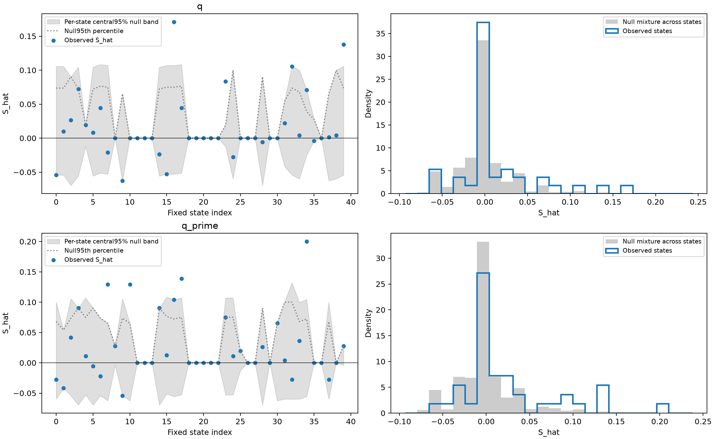
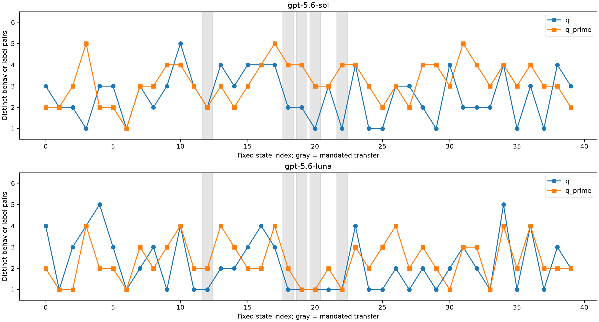
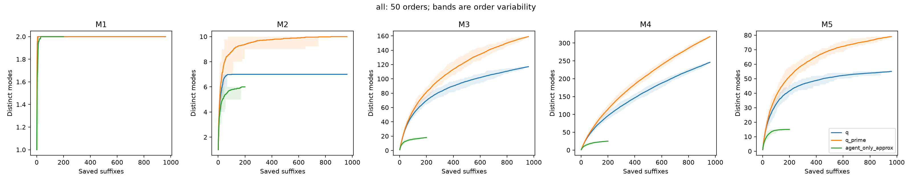
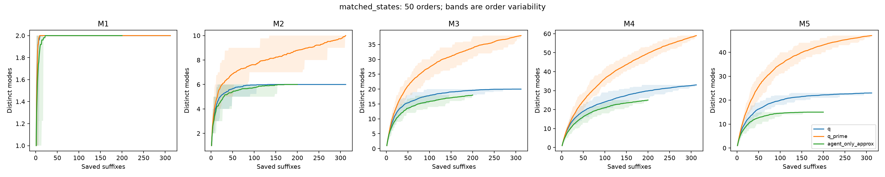
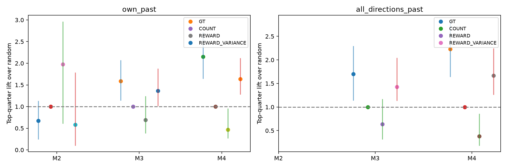

# P4 v7 — Tier A report

Tier A completed on the existing 40 states / 20 tasks, 480 executed partner blocks and 1,920 paired suffixes. No new agent or partner continuations. E1 reuses the corrected frozen v6.1 follow-up (2,000 permutations, 1,000 task-cluster bootstraps, 480 blocks × Sol/Luna labels); E0 adds 855 frozen Sol temperature-0 annotation jobs. All judgments remain model labels, with no human ground truth or relabeling.

Main reading: partner replies matter at some telecom states, but the candidate bank remains null-compatible. M3/M4 retain structural diversity, and GT predicts held-out new-mode counts better than random allocation in these saved data. Neither a confirmed harmful case nor a persistent-behavior effect has yet been demonstrated.

Models in the source batch: Luna agent, Luna native/VS partner (temperature 1); each arm has 6 blocks × 4 suffixes per state. Frozen executed-block labelers are Sol and Luna temperature 0; all new E0 calls are Sol temperature 0.

## E0 — implementation and mechanism checks

| Check | Run / result | Reading |
| --- | --- | --- |
| a: private scenario | 5 exact proposal request payloads archived; private task scenario in system; explicit runtime device snapshot absent | The strong omission hypothesis is unsupported. VS and native q can read device facts through tools. |
| b: next turn | q undo 39/816; q′ undo 113/836 | Single-labeler provisional judgment; see censoring and judge limitation below. |
| c: branch context | 10/10 reconstructed original inputs identical; 20/20 sampled inputs match captured requests | Original IID raw requests unavailable; reconstructed source-policy/message input is explicitly distinguished. |
| d: rejected proposals | 61 rejects vs 240 accepted; descriptive deviation union 39/61 vs 184/240 | Reject reasons are dominated by transfer protocol; overall deviation coding is not enriched among rejects. State/retry composition differs. |
| e: five-way VS batches | 301 batches / 1,505 intended candidates; mean distinct intended labels 2.638; proposed tool patterns 1.764 | Unselected candidates were never executed; intended patterns cannot stand in for five-way execution. |

| Private-context judgment | q (out of 240) | q′ (out of 240) |
| --- | --- | --- |
| mentions_private_scenario | 184 | 191 |
| device_state_report | 103 | 58 |
| device_tool_action | 79 | 30 |
| unobserved_device_claim | 18 | 9 |

| Next native partner relation | q | q′ |
| --- | --- | --- |
| continues | 437/816 | 515/836 |
| neutral | 340/816 | 208/836 |
| contradicts_or_undoes | 39/816 | 113/836 |
| No next partner turn (censored) | 144 | 124 |

The next-turn labeler sometimes explains an “undo” by the agent’s repair rather than the partner’s behavior. We preserve these frozen labels and do not turn the reported rate into a validated regression effect. Missing next turns are censored, not neutral. Private-state mention/action coding is also model judgment, not proof of what motivated the generator. Per-state numerators and denominators are saved in E0 JSON files.

Rejection reasons are mechanically grouped by disclosed ordered regex rules: {'unrequested_tool': 7, 'unsupported_device_report': 13, 'scenario_inconsistency': 3, 'protocol_transfer': 35, 'other': 3}. The accepted/rejected distributions use the identical frozen E1 Sol core prompt. Selection and task composition prevent a causal conclusion that fidelity filtering caused the absent sensitivity contrast.

Plain-language reading: neither missing private instructions nor a changed reconstructed branch prompt explains the batch by itself. The proposal/filter interface is narrower than unrestricted partner behavior, and downstream turns may repair branch behavior. The current annotation establishes where to inspect; E6/E7 are needed to test those mechanisms by execution.

Saved root proposal selections differ from accepted execution candidates in 0/240 checks. Exact root payloads and actual executed blocks are retained separately; root intended-batch statistics cannot be substituted for executed-batch diversity.

## E1 — null, sensitivity level, behavior and tail

| Bank | Direction | Observed | Null mean | Null 95th | p | Null / observed |
| --- | --- | --- | --- | --- | --- | --- |
| q_only | harmful | 22 | 19.2840 | 24.0000 | 0.2214 | 0.8765 |
| q_only | beneficial | 17 | 17.3070 | 22.0000 | 0.6072 | 1.0181 |
| q_only | unfaithful | 2 | 0.8470 | 2.0000 | 0.2044 | 0.4235 |
| q_prime_only | harmful | 44 | 43.7830 | 48.0000 | 0.5372 | 0.9951 |
| q_prime_only | beneficial | 45 | 42.7220 | 47.0000 | 0.2489 | 0.9494 |
| q_prime_only | unfaithful | 0 | 0.0000 | 0.0000 | 1.0000 | undefined |
| pooled_exact_original | harmful | 66 | 62.6100 | 69.0000 | 0.2324 | 0.9486 |
| pooled_exact_original | beneficial | 62 | 60.0290 | 67.0000 | 0.3498 | 0.9682 |
| pooled_exact_original | unfaithful | 2 | 0.8470 | 2.0000 | 0.2044 | 0.4235 |

| Cohort | Family | Mean S_hat [task-cluster 95% CI] | Null mean / 95th | p | Own-null exceedances |
| --- | --- | --- | --- | --- | --- |
| all40 | q | 0.0143 [0.0004, 0.0315] | -0.0001 / 0.0080 | 0.0050 | 5/40 |
| all40 | q_prime | 0.0258 [0.0092, 0.0446] | -0.0001 / 0.0083 | 0.0005 | 5/40 |
| open_union | q | 0.0175 [0.0006, 0.0377] | -0.0001 / 0.0098 | 0.0050 | 5/33 |
| open_union | q_prime | 0.0305 [0.0120, 0.0546] | -0.0001 / 0.0101 | 0.0005 | 5/33 |

gpt-5.6-sol; open nontransfer states:

| q distinct | q′ distinct | Paired delta [CI] | New-label share [CI] | Label S contrast [CI] | Raw between-label share [CI] |
| --- | --- | --- | --- | --- | --- |
| 2.7576 [2.3143, 3.2060] | 3.1515 [2.8000, 3.5360] | 0.3939 [-0.1516, 0.9688] | 0.4293 [0.2904, 0.5678] | 0.0163 [0.0010, 0.0309] | undefined [0.0800, 0.2034] |

gpt-5.6-luna; open nontransfer states:

| q distinct | q′ distinct | Paired delta [CI] | New-label share [CI] | Label S contrast [CI] | Raw between-label share [CI] |
| --- | --- | --- | --- | --- | --- |
| 2.3939 [1.9706, 2.8788] | 2.5152 [2.2857, 2.7812] | 0.1212 [-0.3637, 0.5759] | 0.3434 [0.2121, 0.4844] | 0.0022 [-0.0170, 0.0200] | undefined [0.0571, 0.1395] |

Kappa on all 480 blocks: action 0.7570; report 0.4742. Five mandated-transfer states are excluded from primary diversity and retained separately in the full JSON. Individual assertion maxima are compared against maxima within synchronized-vector permutations: q 5/40, q′ 7/40 (open: 5/33 and 6/33). All negative estimates and binomial intervals remain in check2_level.json.

E1-d: 12 raw case files (top 8 / bottom 4 screening contrasts) are in ../v7_e1_20261004/cases/. They contain the request, all 12 blocks, both frozen labels, all four suffix outcomes and next turns. These are inspection material, not independently confirmed harmful or beneficial case studies.

Plain-language reading: the native sensitivity level exceeds its permutation null, so “the partner does not matter” is unsupported. The mean broadening contrast remains +0.0115 [-0.0031, 0.0271]. The candidate bank is consistent with no-effect noise; null-count ratios 0.949/0.968 are aggregate noise diagnostics, not entry-specific FDR. Novel labels occur, but the distinct-label difference is uncertain and report-axis agreement modest. Do not force A/B/C; D still applies.

## E2 — mode definitions and discovery curves

Modes are mechanical: M1 reward; M2 reward + semantic assertion pattern; M3 M2 + task-touched device leaves + next agent action type; M4 M3 + ordered tool names (repetitions retained); M5 frozen Sol behavior × M2. Numeric device values are abstracted to negative/zero/positive, categorical values retained. Task-touched fields include deterministic replay changes at every executed mutating tool, including fields later reverted, and explicit initialization leaves. Instruction types use a fixed disclosed rule in tier_a.py. Modes are global semantic keys rather than unique state IDs.

| Mode | Source | n | Distinct | f1 / n (GT) | Chao1 | Source-exclusive / distinct |
| --- | --- | --- | --- | --- | --- | --- |
| M1 | q | 960 | 2 | 0/960 = 0.0000 | 2.00 | 0/2 |
| M1 | q_prime | 960 | 2 | 0/960 = 0.0000 | 2.00 | 0/2 |
| M1 | agent_only_approx | 200 | 2 | 0/200 = 0.0000 | 2.00 | 0/2 |
| M2 | q | 960 | 7 | 0/960 = 0.0000 | 7.00 | 0/7 |
| M2 | q_prime | 960 | 10 | 0/960 = 0.0000 | 10.00 | 3/10 |
| M2 | agent_only_approx | 200 | 6 | 0/200 = 0.0000 | 6.00 | 0/6 |
| M3 | q | 960 | 117 | 31/960 = 0.0323 | 143.69 | 32/117 |
| M3 | q_prime | 960 | 159 | 51/960 = 0.0531 | 205.45 | 76/159 |
| M3 | agent_only_approx | 200 | 18 | 3/200 = 0.0150 | 20.25 | 0/18 |
| M4 | q | 960 | 246 | 140/960 = 0.1458 | 542.97 | 131/246 |
| M4 | q_prime | 960 | 318 | 190/960 = 0.1979 | 710.39 | 208/318 |
| M4 | agent_only_approx | 200 | 25 | 5/200 = 0.0250 | 28.12 | 0/25 |
| M5 | q | 960 | 55 | 6/960 = 0.0063 | 61.00 | 11/55 |
| M5 | q_prime | 960 | 79 | 14/960 = 0.0146 | 91.25 | 35/79 |
| M5 | agent_only_approx | 200 | 15 | 0/200 = 0.0000 | 15.00 | 0/15 |

Agent-only approximation: 13 states / 200 suffixes, the largest repeated q block per state. It is a subset of q and was not the original reply held fixed in fresh continuations; zero exclusive modes is guaranteed by inclusion. Matched-state statistics accompany all-state statistics, with 50 random orders and order-variability bands. An equal-budget endpoint comparison at 200 suffixes per source is saved in common_budget_comparison.json. The approximation includes 120/200 suffixes from five mandated-transfer states, versus 120/312 in the matched q arm. Therefore an equal total budget still differs in state weights and cannot isolate partner variation. Unequal observation budgets and the narrow matched cohort prevent a causal diversity comparison.

Plain-language reading: M1 saturates immediately; M2 is coarse. M3/M4 retain more structure without nearly one new mode per suffix. q′ reaches additional saved structural modes, but mode novelty alone is not a verified change in final success. M4 can split repetitions and recovery paths that are incidental; M3 is a plausible compact choice, subject to E3 and fresh validation. M5 depends on unstable model labels and is supplementary.

## E3 — held-out discovery signal

80 (state, family) directions. Replies 1–3 / 4–6 provide 12 past / 12 future suffixes, then swap and average. Signals: GT=f1/12, COUNT=1/14 (one known prefix visit, degenerate), reward mean, reward variance. Cluster bootstrap: 1,000 task resamples, keeping states/families/folds together. Target suffixes are novel against own past or all directions’ past. Global novelty is frozen against the original past, not recomputed inside cluster resampling. Boundary ties get fractional uniform selection; undefined correlation stays undefined.

| Mode | Target | Signal | Spearman [CI] | Top-quarter precision [CI] | Capture [CI] | Lift [CI] |
| --- | --- | --- | --- | --- | --- | --- |
| M2 | own_past | GT | -0.0525 [-0.1739, 0.0926] | 0.0143 [0.0042, 0.0288] | 0.1682 [0.0609, 0.2834] | 0.6729 [0.2434, 1.1334] |
| M2 | own_past | COUNT | undefined | 0.0214 [0.0104, 0.0333] | 0.2500 [0.2500, 0.2500] | 1.0000 [1.0000, 1.0000] |
| M2 | own_past | REWARD | 0.1232 [-0.0746, 0.3123] | 0.0420 [0.0128, 0.0792] | 0.4935 [0.1515, 0.7412] | 1.9739 [0.6060, 2.9649] |
| M2 | own_past | REWARD_VARIANCE | -0.0756 [-0.2772, 0.1153] | 0.0112 [0.0021, 0.0338] | 0.1451 [0.0249, 0.4466] | 0.5805 [0.0998, 1.7866] |
| M2 | all_directions_past | GT | undefined | 0.0007 [0.0000, 0.0028] | undefined | undefined |
| M2 | all_directions_past | COUNT | undefined | 0.0016 [0.0000, 0.0042] | undefined | undefined |
| M2 | all_directions_past | REWARD | undefined | 0.0000 [0.0000, 0.0000] | undefined | undefined |
| M2 | all_directions_past | REWARD_VARIANCE | undefined | 0.0019 [0.0000, 0.0098] | undefined | undefined |
| M3 | own_past | GT | 0.4427 [0.1989, 0.6216] | 0.2715 [0.1682, 0.3577] | 0.3972 [0.2849, 0.5180] | 1.5887 [1.1396, 2.0720] |
| M3 | own_past | COUNT | undefined | 0.1708 [0.1161, 0.2245] | 0.2500 [0.2500, 0.2500] | 1.0000 [1.0000, 1.0000] |
| M3 | own_past | REWARD | 0.0375 [-0.2459, 0.3205] | 0.1181 [0.0648, 0.2125] | 0.1732 [0.0949, 0.3103] | 0.6926 [0.3796, 1.2410] |
| M3 | own_past | REWARD_VARIANCE | 0.3786 [0.1466, 0.5681] | 0.2329 [0.1583, 0.3033] | 0.3404 [0.2535, 0.4693] | 1.3614 [1.0142, 1.8772] |
| M3 | all_directions_past | GT | 0.4317 [0.2026, 0.6094] | 0.1687 [0.0931, 0.2469] | 0.4257 [0.2849, 0.5740] | 1.7027 [1.1394, 2.2962] |
| M3 | all_directions_past | COUNT | undefined | 0.0995 [0.0625, 0.1375] | 0.2500 [0.2500, 0.2500] | 1.0000 [1.0000, 1.0000] |
| M3 | all_directions_past | REWARD | 0.0067 [-0.2348, 0.2599] | 0.0636 [0.0271, 0.1255] | 0.1595 [0.0783, 0.2925] | 0.6381 [0.3132, 1.1700] |
| M3 | all_directions_past | REWARD_VARIANCE | 0.3921 [0.1694, 0.5702] | 0.1421 [0.1021, 0.1901] | 0.3568 [0.2831, 0.5120] | 1.4273 [1.1324, 2.0480] |
| M4 | own_past | GT | 0.7320 [0.5586, 0.8199] | 0.6451 [0.4662, 0.7688] | 0.5377 [0.4108, 0.6785] | 2.1509 [1.6432, 2.7140] |
| M4 | own_past | COUNT | undefined | 0.3005 [0.1885, 0.4125] | 0.2500 [0.2500, 0.2500] | 1.0000 [1.0000, 1.0000] |
| M4 | own_past | REWARD | -0.0301 [-0.3546, 0.3112] | 0.1407 [0.0787, 0.3125] | 0.1168 [0.0666, 0.2401] | 0.4673 [0.2665, 0.9604] |
| M4 | own_past | REWARD_VARIANCE | 0.5345 [0.3053, 0.6944] | 0.4913 [0.3163, 0.6497] | 0.4098 [0.3200, 0.5309] | 1.6393 [1.2800, 2.1237] |
| M4 | all_directions_past | GT | 0.7275 [0.5543, 0.8214] | 0.5007 [0.3498, 0.5750] | 0.5576 [0.4095, 0.7039] | 2.2306 [1.6381, 2.8155] |
| M4 | all_directions_past | COUNT | undefined | 0.2245 [0.1401, 0.3125] | 0.2500 [0.2500, 0.2500] | 1.0000 [1.0000, 1.0000] |
| M4 | all_directions_past | REWARD | -0.0863 [-0.3929, 0.2438] | 0.0851 [0.0391, 0.2091] | 0.0948 [0.0455, 0.2149] | 0.3793 [0.1820, 0.8597] |
| M4 | all_directions_past | REWARD_VARIANCE | 0.5412 [0.3018, 0.7179] | 0.3746 [0.2428, 0.4896] | 0.4172 [0.3153, 0.5615] | 1.6687 [1.2612, 2.2459] |

Plain-language reading: GT has positive held-out predictive value for M3/M4. Against the global past, M3 Spearman is 0.432 [0.203, 0.609] and top-quarter lift 1.703 [1.139, 2.296]; M4 is 0.728 [0.554, 0.821] and lift 2.231 [1.638, 2.815]. Reward variance also predicts novelty; these results do not establish a significant GT advantage over reward variance, because no paired difference test was specified. COUNT has no ranking information here and yields random allocation exactly. This supports testing GT as an internal allocation signal, while distinguishing structural path discovery from independently verified outcome changes. The split is held-out reply draws, not an adaptive search trial. Full fold metrics, valid bootstrap counts and raw targets are retained.

## Cross-experiment reading

| Hypothesis | Evidence / remaining uncertainty |
| --- | --- |
| 1. Wrong statistic / few pivots | E1 has state-tail raw files and nonzero native sensitivity, while bank screening is largely null-compatible. Independent E4 retests are still required; mean contrast cannot settle a tail hypothesis. |
| 2. Wrong unit / persistent behavior | E0-b identifies provisional next-turn reversals with a censored baseline; no persistent intervention was run. E7 remains the test. |
| 3. Wording vs behavior | E1-c new-label shares are substantial, distinct-count CIs cross zero, and Sol/Luna disagree especially on reports. E0-e exposes limited within-batch intended behavioral variety. Not established as wording-only. |
| 4. Implementation | Private task instructions present; explicit DB snapshot absent; 10 reconstructed branch inputs and sampled request checks audited. Filtering rejects some behavior deviations. E0 does not prove a context bug or quantify its causal effect. |
| 5. Unsuitable environment | Native S exceeds permutation null; telecom is not partner-irrelevant. A cross-model/environment comparison E5 has not been run. |
| 6. Premise wrong | Not established: insignificant mean broadening is not equivalence, bank is unverified, and tail/persistence remain untested. |

Q1: M3/M4 are usable candidates, with exact definitions and discovery curves archived. Q2: persistent behavior remains unresolved. Q3: GT predicts held-out structural novelty and merits a controlled loop comparison; no adaptive benefit is yet demonstrated. Q4: no environment-switch conclusion without E5. Tier B has not started; this report is the requested Tier A reading milestone.

## Provenance, accounting and caveats

New annotation requests: 915 ledger records; returned prompt tokens 2,051,943, completion tokens 178,677. Reused E1 calls/tokens are accounted separately in labeler_usage.json. Interrupted/failed requests without returned usage have unknown provider-side usage. New requests are redacted in v7_tier_a_20261004/requests/. Prompts were frozen before annotation; no tuning on the data. Source hashes verified in audit.json; no historical run changed.

Validation: seven targeted tests pass (mode boundaries, replay-state agreement, curve endpoints, held-out split/global novelty, fractional ties and degenerate signals); Ruff check and format pass for the three new analysis files.

q used temperature 1.0, whereas the τ² paper evaluates the user simulator at temperature 0. This comparison uses an already-diverse native partner, not standard benchmark practice. No new temperature-0 arm was added. Reused preregistration and arithmetic amendment are preserved; the binary estimator retains the integer-equivalent calculation and exact-tie tolerance. Exploratory E0/E2/E3 rules/seeds are in plan.json and tier_a.py; these are exploration results, not new preregistered confirmatory tests.
